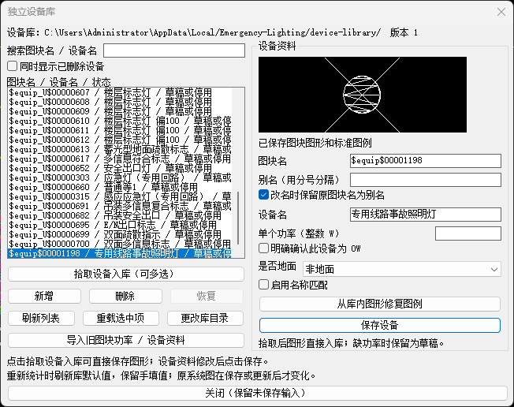
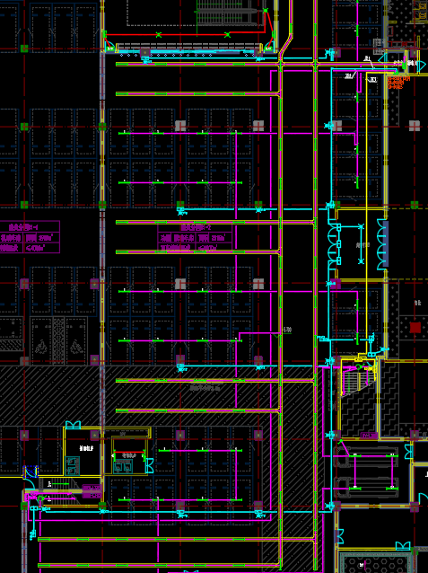
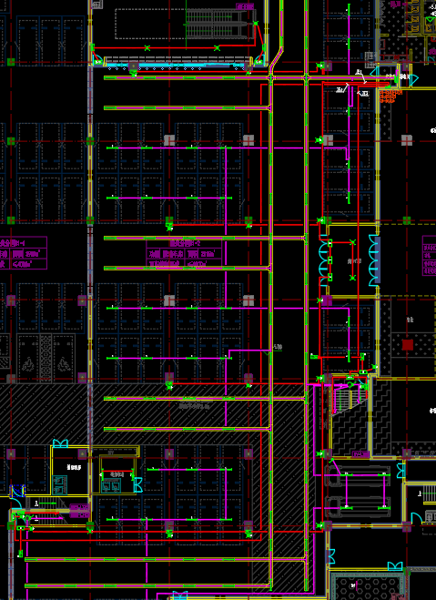

# 应急照明回路统计与系统图生成

日期：2026-10-21
状态：v0.1.67 为当前性能分支的原图复测测试版；未合并、未发布，原生 CAD 待复测

基于 **AutoLISP + DCL** 的 AutoCAD 辅助设计工具，用于应急照明平面图的回路识别、设备数量与功率统计、设备库管理，以及新系统图生成。

当前测试版为 `v0.1.67`，提供完整版 `应急照明-v0.1.67.zip`。完整解压后，用 APPLOAD 加载根目录 **ELFULL67.lsp**，输入新命令 **ELFULL67**。找不到解压目录时仍自动使用自包含本地运行目录。

本测试版包含受约束的同块同姿态轮廓复用、模板检查复用、默认使用本图系统图块、候选去重及生成/放置细分计时。请使用相同原图副本、箱体和回路起点复测，每次完成或取消后、关闭图纸前运行 `ELDIAG`，保留本次完整诊断文件夹，可自行压缩后反馈。详见 [v0.1.67 测试说明](docs/更新记录/v0.1.67-识别与系统图性能原图测试版.md)。

连续选择导线时，空白点击提示后继续等待，已选项保留；按 Enter 完成，Esc 取消。旧内置图层预设即使保存过设备名称也会补上 `LITE_应急照明_E`，原设备名和自定义图层不改。诊断记录实际识别图层与名称范围，详见速查第 51、52 节。

v0.1.63 精简入口在直接 LOAD 且不在支持路径时仍无法定位，当前改用上述完整版入口；旧包保留，不宣称已修好旧 ELTEST。详见速查第 50 节。

本版补齐商业照明原图缺失的圆灯、楼层标志及其图层，新增用户指定的 `f`、`$equip_U$00000719(Zhangyufeng)`；支持新设备的椭圆轮廓。无设备的实际回路显示“未识别设备”，未知功率显示“功率待核对”。修复 `ELTEST` 自动弹选文件窗口，复用本次导线接触范围并纠正耗时归类。详见 [速查第 48、49 节](docs/05_常见错误原因与修复速查.md)。

`v0.1.62` 源码将精简版业务模块合入单一加载入口，避免逐个模块触发安全确认；安装目录仍须符合 AutoCAD 的信任设置。面板恢复标准“关闭”按钮，Esc 和右上角叉叉使用同一退出回调。当前安装的 CADTools 尚未包含这些修改，详见 [v0.1.62 修复记录](docs/更新记录/v0.1.62-精简加载与面板退出修复.md)。

对照历史故障复查后，还补齐了首次启动失败后的 `ELROOT` 恢复、注册表异常及支持路径定位处理。已核对历史业务修复的保留情况，本次原图定位及边界补充在第 49 节，见 [常见错误速查](docs/05_常见错误原因与修复速查.md)第 47 节。

新增供 CADTools 集成的 `lite-v0.1.61` 精简运行模式，版号自动与完整版同步。保留现有功能和命令，去除重复启动内容与历史开发资料；配置、日志写入用户目录。2026-10-16 按用户要求提供 `应急照明-lite-v0.1.61.zip` 及同名解压目录，供 CADTools 项目接入；菜单集成及原生 CAD 验收待完成，详见 [CADTools 精简运行版](docs/CADTools精简运行版.md)。

主要流程：**拾取配电箱与回路起始导线 → 查看识别结果并修正遗漏 → 生成一张新系统图**。生成时自动保存当前输入；平面修改后需重新拾取并核对。每次成功生成都新建系统图，旧图实体保留。

## 视频与界面展示

[查看使用文档与演示视频（飞书）](https://my.feishu.cn/wiki/Q9jVwS6cIiuDLtk9poBcS3oXnFd?create_from=create_doc_to_wiki)

### 回路与图块设置

主面板用红色的第一步至第四步编号显示拾取、容量、查看回路和生成系统图的操作顺序；第三步下方可检查本图系统图块或从图库补入缺项，再按第四步生成。右侧集成设备库编辑，保留独立 `ELDEVLIB` 入口。设备库路径下方提供“图块图纸：系统图块库.dwg”和“打开所在文件夹”按钮。

`ELSTAT` 首次打开时先收起设备库，显示窄窗口；第四步下方提供“展开设备库 >> / 收起设备库 <<”。展开后恢复完整右侧编辑区和库文件路径，同一 CAD 会话记住显示状态。切换保留回路、容量、设备选中项及搜索条件；收起前保存当前资料，保存失败时留在展开状态。详见 [v0.1.56 更新记录](docs/更新记录/v0.1.56-设备库展开与收起.md)。

当前回路行按 `ZE1`～`ZE8` 显示标签，每行下方有横线，标签后的色块与第三步临时预览使用同一份配色；排除红色、绿色、洋红色及对应色系，并继续避开原导线颜色。列表下方、第三步上方显示去重后的总功率；功率或连接待核对时显示“已知总功率”。容量选项下方的默认值说明已移除。详见 [v0.1.58 更新记录](docs/更新记录/v0.1.58-回路分隔与预览色块.md)及 [v0.1.59 更新记录](docs/更新记录/v0.1.59-总功率汇总与诊断入口精简.md)。

固定系统图最多容纳 8 条实际回路。识别到 9 条及以上时，打开面板即提示实际条数、8 条上限和拆分配电箱的处理方式；列表只显示前 8 条，全部回路数据保留，点击生成仍会拦截。返回预览或切换设备库时不重复弹出打开提示。

诊断区提供“导出诊断日志并打开文件夹”按钮，导出成功后自动打开本次资料的位置；失败时显示原因，打开失败时提示完整路径。`v0.1.62` 源码在其下方恢复正常尺寸的“关闭”按钮，用于原生 Esc 和叉叉分派；无效或保存失败的编辑输入留在当前 CAD 会话，关闭时不重算功率。底部提示、诊断路径框及单独的打开按钮仍已移除。

2026-10-16 曾按用户要求生成 `应急照明-v0.1.61.zip`，包含去除空白退出按钮的修改；该历史包保持原样，不包含 `v0.1.62` 源码修复。详见 [v0.1.61 更新记录](docs/更新记录/v0.1.61-去除空白退出按钮.md)。

用户曾确认 v0.1.60 的 Esc、叉叉和空白按钮均可退出；v0.1.61 为去掉边框改用文本接收项，2026-10-20 收到 Esc 和叉叉失效反馈。`is_cancel` 必须使用按钮控件，因此 `v0.1.62` 恢复标准按钮，原生退出行为仍待新交付物实测。

旧版面板截图供界面对照；当前主面板已精简。

### 独立设备库

集中管理设备图形、图例、名称、功率及地面属性。修改后点击“保存设备”，确认下方显示本次设备名及功率，例如“已保存并核对：备用照明，5 W。”；自动保存同时保留。选择条目保持列表滚动位置，名称与状态变化只更新对应行。完成后通过“功率参数”旁的“打开所在文件夹”定位当前 `catalog.eld`，发送此文件作为默认功率来源。

“导出设备库”生成包含 `catalog.eld`、当前图形及图例的文件夹；“导入设备库”选择其中的 `catalog.eld`，复制为当前用户的独立设备库并切换使用，原设备库保留。只反馈默认功率仍可单独发送 `catalog.eld`；转移完整设备库时需一起提供 `assets`。

当前自带设备库已按用户导出文件更新：49 项图形与图例齐全；46 个未删除灯具默认启用名称匹配，其中 35 项为 1W、11 项为 5W。两项漏填的疏散标志按用户确认补为 1W，配电箱及两条已删除记录保持空功率。加载程序即自动使用这些默认值，无需点击“导入设备库”。旧版尚未修改的空功率默认项，以及本次已确认的作者保存库，自动升级为可匹配的默认功率；后续个人修改、停用和删除继续保留。升级沿用当前用户库目录，不另建或切换库。详见 [v0.1.57 更新记录](docs/更新记录/v0.1.57-加载时自动升级默认功率.md)。



### CAD 回路拾取效果

拾取到的回路会整体变色，便于在 CAD 平面图中直观看到识别范围，并核对回路路径和设备归属。下面两张截图展示回路拾取后的整体变色效果。






历史公开版本为 [v0.1.0 Release](https://github.com/WuwuZhang0019/Emergency-Lighting/releases/tag/v0.1.0)。下载并完整解压 `Emergency-Lighting-v0.1.0.zip` 后，使用 `APPLOAD` 加载包内 `START-CAD2020.lsp`。运行 `ELDEVLIB` 可使用随包附带的 49 项天正默认图形和图例（1 个配电箱、48 个设备）。首次加载自动建立当前 CAD 用户的设备库，功率留空待填写；已有功率、设备名称、地面设置和删除状态保留。无需另装设备库或手动更改库目录。

## 核心功能

| 功能 | 当前行为 |
| --- | --- |
| 回路与设备识别 | 从选中的起始导线沿回路搜索相关设备，按真实几何接触判定归属 |
| 回路核对 | 当前箱面板显示回路编号、功率、设备数量与待核对状态；可按需在图面分色预览 |
| 独立设备库 | 管理图形、图块名、设备名、功率和地面属性，支持新增、查找、修改、删除及恢复，材料表复用标准图例 |
| 平面回路编号 | 读取天正导线 `linenum`，统计面板与系统图使用同一编号；未标号补默认号并避开已占号 |
| 系统图生成 | 每次成功生成一张新图；旧图实体留在图纸中，当前箱只保留一份可编辑输入记录 |
| 保存输入 | 放置前将当前箱输入和回路结果写入 DWG 并回读验证；出图完成后不再重复写入 |
| 诊断导出 | 主面板“导出诊断日志并打开文件夹”按钮收集本次资料，成功后自动打开所在位置，失败时保留原始原因 |

识别以实际几何连接为依据，不能将仅仅靠近但未接触的设备直接纳入。连接、编号或参数存在歧义时，应按提示核对。

## 快速开始

### 1. 环境与加载

- 主要交付目标：Windows AutoCAD 2020；图纸单位固定 **mm**。
- 从 [v0.1.0 Release 下载交付包](https://github.com/WuwuZhang0019/Emergency-Lighting/releases/download/v0.1.0/Emergency-Lighting-v0.1.0.zip)，完整解压并保留包内全部目录。交付 ZIP 不纳入 Git。
- 在 CAD 中运行 `APPLOAD`，只加载解压目录中的 **`START-CAD2020.lsp`**；命令行应显示目录已确认并提示输入 `ELSTAT`。
- 包内全部 `.lsp` / `.dcl` 使用严格 GB2312。**不要在 AutoCAD 2020 中直接加载仓库 UTF-8 源文件**，也不要混用不同版本的入口和模块。
- 源码面向 Windows AutoCAD 2021+、`LISPSYS=1/2` 环境；具体 CAD 与天正对象表现仍需实测。
- 设备库图形登记涉及多图纸操作，需要 `SDI=0`。

### 2. 准备设备及编号

加载完整包后，自带设备已自动初始化或升级，可直接用于统计；运行 `ELDEVLIB` 查看默认功率。新增其他设备时，再登记设备图形、有效图块名、设备名、整数功率（W）及是否地面。主面板和独立设备库均自动保存：修改文本后按 Tab、点击其他位置或选择下一条设备即写入文件；勾选和下拉选项修改后立即保存。缺资料时保存为停用草稿；明确的 0W 需要确认，不能将空功率默认为 0W。无修改时不重复写入。保存失败保留输入并显示原因；打开其他功能前会重试待保存项，失败时留在编辑器，可修正输入或用“重载选中项”恢复已保存资料。独立设备库关闭前仍会重试；主面板使用 Esc 或叉叉始终退出，未保存输入保留到当前 CAD 会话下次打开面板时继续处理。

设备库顶部标明“功率参数：catalog.eld”，点击旁边“打开所在文件夹”可直接定位该文件。确认状态显示“已自动保存”后，只反馈功率等参数时发送 `catalog.eld` 即可；设备图形或图例也有变化时再附 `assets/`。默认位置为 `%LOCALAPPDATA%\Emergency-Lighting\device-library\catalog.eld`，更改过库目录时以当前界面为准。

未完成的图例生成任务不再阻止 `ELSTAT` 或 `ELDEVLIB` 打开参数编辑器；仍可修改已有设备功率并自动保存。任务及其文件保留，任务完成前暂不启动新的拾取、修复、导入或库目录切换操作。

如果需要沿用平面编号，先手工使用天正 `HLBH` 标号，再提取配电箱。程序读取配电箱至各支路首个设备之间源导线的 `linenum`；未标号回路按面板顺序补默认号并避开已占号。重号、多个候选号或读取异常时，修正平面后重新提取。

### 3. 统计与核对

1. 运行 `ELSTAT`，拾取配电箱和编号，再连续拾取各回路起始导线；靠近箱体的一端确定搜索方向，按 Enter 完成。
2. 主面板查看回路编号、功率及设备状态。点击“在图面查看全部回路”核对路径；遗漏或误归属时修正平面连接、设备库资料或重新拾取。
3. 核对容量后点击“生成新系统图”，程序自动保存当前输入；不再提供独立暂存按钮。生成后仍须保存 DWG。

142 版在放置前保存输入，在鼠标确认箱体位置后、创建各回路之前核对源图。全部图块和文字完成后，只关闭撤销组并恢复命令设置，不再重复保存出图主记录、复扫源图、全图重生成或缩放定位。实际完成延迟仍需原图实测。详见 [142 更新记录](docs/更新记录/142-放置结束与手动诊断导出.md)。

### 4. 生成系统图

生成默认使用本图已有的箱体块 `ZYF_Tool_应急照明配电箱图块`、回路块 `ZYF_Tool_应急照明配电回路图块` 及文字样式 `_TEL_DIM`、`ICDA-STYLE1`，不自动打开图库。面板会列出缺少的图块和样式；“检查本图图块”只使用本图定义，“从图库补入缺项”才从随包 `templates/系统图块库.dwg` 补入缺少内容。两个准备按钮完成后都返回原面板，容量、功率及识别结果保留，再点击“生成新系统图”。已有同名定义不会被自动重定义；动态属性或允许状态不兼容时停止并输出具体原因。可在右侧打开图块文件夹查看原始 DWG。回路用途默认文字为“疏散指示及应急照明”。这些来源选择行为属于当前源码，尚未重新打包。

- `1～8` 条实际回路最多输出 8 行；有剩余行时补最多 2 条预留回路，不创建功率文字。超过 8 条实际回路时停止生成并提示拆分配电箱，不截断回路。
- 文字使用 `_TEL_DIM`，高度 350、宽度因子 0.7，图层为 `TEL_TEXT`。
- 每次生成由 `CCKK2` 原生鼠标放置；Esc 可取消本次插入。
- 放置后保持当前视角。需要诊断时，重新打开 `ELSTAT`，点击左侧“导出诊断日志”，也可直接运行 `ELDIAG`。
- 仅设备功率缺失时可继续生成：问题回路保留图块和编号，功率文字留空；不会把未知值写成 0W，也不会把该回路的已知部分小计当成总功率。正常回路照常标注，面板保留“功率待核对”和已知总功率提示。
- 点击“查看/补填设备功率”，缺项设备排在前面，可查看图块名、真实回路编号、缺项原因及每个设备句柄。选择实例后点“图面定位所选设备”，按 Enter 或 Esc 返回核对窗口。无需先录入完整设备库。
- 输入单个功率后点击“应用本箱同名设备功率”，仅重算当前已识别设备的功率；返回原回路面板可直接生成，不重跑回路识别。0W 需勾选确认，留空表示仍待核对。应用值属于本箱，不改公共设备库；生成时随当前输入保存。切换行或图面定位保留尚未应用的输入，返回回路面板会丢弃未应用输入。
- 识别不完整、未识别到设备、编号或连接冲突、功率计算溢出、设备库不可读、超过当前程序 172W 限制仍需处理后生成。172W 是当前程序规则，不代表通用规范限值。

### 5. 后续修改

平面设备、导线或编号改变后，重新运行 `ELSTAT` 拾取并核对，再生成新图。程序不会自动修改旧系统图；旧图如不再需要，由设计人员在 CAD 中自行处理。当前箱的旧记录会在下次已验证保存时被新输入替换。

程序没有常驻监听；手工布局、锁层、撤销及数据优先级详见 [加载、使用与验收说明](docs/03_加载使用与验收说明.md)。

正常 `ELSTAT` / `ELGEN` 的诊断事件和耗时先留在内存，点击导出时写入独立的 `ELDIAG-<时间>` 文件夹；不依赖 PowerShell、压缩进程或 ZIP 完成状态。可直接发送该目录中的资料，或自行压缩后发送。打开面板导出后再取消，不会覆盖上一次有效运行记录。每张打开的图纸保留最近一次有效运行和最近一次成功出图的关联资料。**请在关闭图纸前导出诊断**；图块、文字和已保存输入仍随 DWG 保存，内存中的完整出图关联不会在重开图纸后自动恢复。旧版本已写入 DWG 的关联记录仍可按原方式导出。

143 版点击“导出诊断日志”后生成一个 `ELDIAG-日期时间.zip`，包含时间轴、原始事件与耗时、可核对的出图关联、当前图纸保存记录、当前识别结果及已有相关日志。压缩完成并逐文件核对后显示完整 Windows 路径（使用 `\`）；路径框可选中复制，旁边可点击“打开所在文件夹”。直接发送这个 ZIP 即可。缺少关联或成员已删除时，包内记录具体原因，仍保留可收集的诊断信息。压缩失败时保留原始资料目录供复制和打开。详见 [143 更新记录](docs/更新记录/143-诊断压缩包与路径操作.md)。

144 版修复大记录导出卡顿：完整保存记录和关联直接输出到文件，再转换为 UTF-8；当前识别结果只收集业务字段与源图数量，避免重复展开内存几何和设备库缓存。导出时显示逐文件进度，并在包内保存 `progress.log`。同时将诊断脚本正文嵌入 LISP，启动不再写入 `.ps1`；启动命令显示在日志和耗时之后。详见 [144 更新记录](docs/更新记录/144-诊断导出卡顿修复.md)。

## 设备库与数据保存

设备库默认位于运行 CAD 的用户目录：

```text
%LOCALAPPDATA%/Emergency-Lighting/device-library/
```

实际路径显示在设备库窗口中，可更改库目录。备份或迁移时复制完整目录，包括 `catalog.eld`、`assets` 和 `history`；只复制索引不能带走图形与图例。

| 数据 | 管理方式 |
| --- | --- |
| 共享设备库默认值 | 按有效图块名及登记别名匹配；仅在管理器明确保存时修改 |
| 本箱人工值 | 随当前配电箱记录保存，不隐式回写共享库；普通默认值刷新保留人工覆盖 |
| DWG 当前输入 | 每个来源配电箱保留一份可编辑记录；写入需回读验证，关闭前仍需保存 DWG |
| 辅助资料 | `.eld` 用于辅助导出；旧图块功率资料可从设备库导入，补齐图形等资料后启用 |

设备库默认值和人工覆盖在独立 `ELDEVLIB` 中维护。其他窗口修改设备库后，当前面板会刷新默认值并停留供核对，避免提交时混用不同库版本。

### 设备库占用时

设备库占用时，可使用恢复窗口及本图草稿保存路径：

1. 设备库暂不可用时，可先“保存”当前输入为本图待完善草稿，再保存 DWG；该路径不更新系统图。
2. 点击“独立设备库”进入恢复窗口，先结束其他 CAD 对同一库的写入，再勾选确认并执行“检查并恢复占用”。
3. 恢复会检查索引并归档占用标记，保留原内容；不会自动判断所有 CAD 是否仍在写入，也不会自动补齐功率资料。
4. 提示索引损坏或存在未完成发布时，保留整个库目录和日志，不直接删除索引、历史或暂存文件。

详细步骤及现场验收见 [占用恢复与草稿保存的历史说明](docs/更新记录/2026-10-11-设备库占用恢复与本图草稿保存-101.md)、[设备库 CAD 验证与使用说明](docs/14_独立设备库CAD验证与使用说明.md)。

## 常用命令

| 命令 | 用途 |
| --- | --- |
| `APPLOAD` | 加载交付包 `START-CAD2020.lsp` |
| `ELSTAT` | 拾取配电箱和回路起始导线，核对后生成新图并自动保存输入 |
| `ELJBOX` | 拾取接线盒样本，设置或取消同类型分类；重新统计后贯通和分支，接线盒不计负载 |
| `ELDEVLIB` | 独立设备库管理 |
| `ELGEN` | 使用当前统计结果生成新系统图 |
| `ELDIAG` | 将诊断日志和关联资料汇总为 ZIP，命令行显示 Windows 路径 |

旧 `ELTRACE` 按身份功率流程继续兼容；日常固定系统图操作以 `ELSTAT` 流程为主。

## 项目结构

```text
Emergency-Lighting/
├─ src/          UTF-8 AutoLISP 源码
├─ ui/           DCL 界面资源
├─ config/       配置及兼容资料
├─ templates/    模板相关资源
├─ tools/        构建与辅助工具
├─ tests/        检查、样例与验证证据
├─ docs/         方案、使用说明及更新记录
└─ output/       生成的交付包与临时验证产物（不提交）
```

## 开发检查与构建

在仓库根目录使用 Python 执行。只修改文档时检查内容及链接；修改 LISP/DCL 后必须重新构建并执行对应必要检查。

```powershell
# 当前箱、新图生成与真实接触的聚焦检查
python -X utf8 -m unittest discover -s tests -p test_simplified_flow.py -q
python -X utf8 -m unittest discover -s tests -p test_device_contact.py -q

# 有方向的起始导线与回路识别
python -X utf8 -m unittest discover -s tests -p test_circuit_starts.py -q

# 严格转换 GB2312，生成交付目录和 ZIP
python -X utf8 tools/build_cad2020.py

# 核对当前入口、GB2312、ZIP 与解压目录一致性
python -X utf8 tests/check_simplified_package.py
```

生成的压缩包、交付目录及临时验证目录不提交；提交源码、测试、文档及构建脚本。新增生成路径应配置精确 `.gitignore` 规则并验证。

## 验证状态与证据

历史版本留有 **422 项联合回归通过，失败 0、错误 0** 的记录，以及 30 个 LISP/DCL 严格 GB2312 解码与往返一致、28 个 LISP 解析、ZIP 完整性、文件清单、解压目录字节一致性和加载入口检查证据。这些记录对应当时的交付包，不代表 v0.1.0 的原生 CAD 验收。

- [历史联合回归证据](tests/evidence/2026-10-11-device-library-101.json)
- [历史交付包检查证据](tests/evidence/2026-10-11-device-library-package-101.json)
- [平面回路编号证据及 CAD 步骤](tests/evidence/2026-10-11-plane-circuit-numbers.md)
- [保存与插入事务修复证据](tests/evidence/2026-10-09-save-insert-037.md)

自动检查使用有限 CAD/DCL 接口替身，不能替代原生 CAD 的交互、图形外观、真实几何、跨图纸登记、DWG 保存重开与 `UNDO/REDO` 验收。[合成 DXF](tests/fixtures/cad-plan.dxf) 不包含两个真实动态块，不能据此宣称真实图纸全部通过。

真实 AutoCAD 2020 仍需重点验证：完整回路识别及预览、编号对应、设备登记返回、占用恢复、草稿保存重开、首次放置及更新、取消和撤销恢复。日志排查保留 `ELTRACE-debug.log` 与 `ELPERF.log`，以命令行显示的实际路径为准。

## 文档导航

- [加载、使用与验收说明](docs/03_加载使用与验收说明.md)
- [设备库 CAD 验证与使用说明](docs/14_独立设备库CAD验证与使用说明.md)
- [常见错误原因与修复速查](docs/05_常见错误原因与修复速查.md)
- [总体方案](docs/01_应急照明回路统计与系统图生成方案.md)
- [断线导线几何续接方案](docs/02_断线导线几何续接算法方案.md)
- [整箱分回路与功率赋值方案](docs/04_整箱自动分回路统计与设备功率赋值方案.md)
- [固定系统图与功率标注更新方案](docs/06_固定图块系统图与功率标注自动更新方案.md)
- [平面回路编号与系统图对应方案](docs/13_平面回路编号读取与系统图对应开发方案.md)
- [独立设备库与材料表管理方案](docs/13_独立设备库与材料表管理方案.md)
- [设备库统一数据源与自动入库方案（待实施）](docs/15_设备库统一数据源与自动入库方案.md)
- [天正圈选图块导入结果与功率填写](docs/16_天正设备库圈选图块导入说明.md)
- [历史实施记录](tests/evidence/implementation-status.md)

原 P00—P06、B01—B06、S01—S06 等阶段编号及历史结论保留在方案与证据中；阶段自动检查通过不等于真实 CAD 验收完成。
