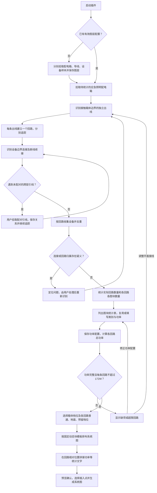
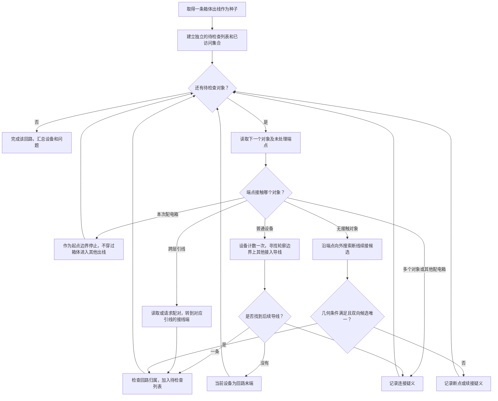

# 01 应急照明回路统计与系统图生成方案

日期：2026-10-05

状态：实施中；P00 基线资料已登记，真实 DWG／动态块及 CAD 验收待提供

版本：V0.2

配套方案：[02 断线导线几何续接算法可执行方案](02_断线导线几何续接算法方案.md)。本文规定整体业务流程；方案 02 细化本文第 5.5 节及 P02、P03 的断线续接实现与验收。

## 1. 目标与范围

用户拾取一个平面图中的应急照明配电箱，程序识别各条独立出线，逐回路统计设备图块数量，读取或填写图块功率，计算各回路总功率，再用用户已有的配电箱、配电回路两个动态块拼接系统图，并在回路的相对位置填写统计文字。

本方案以本次用户确认的绘图规则为依据，以 `参考/FAS_topological_graphV2 - 副本.lsp` 的几何搜索方法为实现参考。172W 是本项目用户明确给定的单回路上限。本文件未开展规范条文核验或其他电气设计计算。

实施记录见 [实施与验收状态](../tests/evidence/implementation-status.md)。P00 已登记合成基线和模板采集字段；真实样图、动态块适配和 CAD 实测尚未完成。

首版建议采用 AutoLISP / Visual LISP 实现，配合 DCL 表单交互，以便直接复用参考代码的实体读取、选择集和几何搜索经验。该技术路线属于方案建议，不是已经存在的实现。

## 2. 已确认的业务规则

| 编号 | 用户确认内容 | 实现约束 |
| --- | --- | --- |
| R01 | 平面设备包括应急照明灯、疏散指示标志灯、安全出口标志灯等，不涉及烟感分类 | 按实际图块归类，不要求统一图块名称；建筑底图和非设备对象仍须排除 |
| R02 | 每条回路有独立管线接到配电箱边缘 | 从箱体边界识别各条出线，每条出线作为独立回路种子 |
| R03 | 无 T 接；导线交叉不连接，交叉处常将其中一根打断 | 普通导线交点不建立连接；打断位置通过方向、端点和距离续接 |
| R04 | 导线在图块两侧断开，端点接触图块边界 | 以设备轮廓作为接入区域，从接入设备寻找另一侧导线；不能只测插入点 |
| R05 | 配电箱、导线和设备具有固定图层，首次分别拾取样本并保存 | 图层从样本读取，后续复用，并提供修改配置入口 |
| R06 | 跨层通常通过引线图块表示，首版允许用户选择配对引线 | 将配对关系作为逻辑连接；引线图块不计为用电设备 |
| R07 | 统计后列图块表填写功率，应急照明灯默认 5W，其他疏散指示、安全出口等标志灯默认 1W | 先归类计数，再确认设备类别及单个功率；名称不明确时由用户指定类别 |
| R08 | 保存用户填写的功率，下次复用 | 已保存值优先；不能用默认值覆盖用户设置 |
| R09 | 系统图配电箱动态块有 0.3kW、0.6kW、1kW 三档 | 用户选择档位，通过真实模板属性映射写入 |
| R10 | 系统图配电回路动态块有普通、地面、预留三档 | 每个输出回路有显式档位；首版由用户选择，不从图块名称猜测 |
| R11 | 统计功率文字放在配电回路的相对位置 | 模板记录相对文字位置、样式及拼接格式 |
| R12 | 单条回路功率不能超过 172W | 小于或等于 172W 合格；超过时显示回路及设备明细，修正后才允许正式生成 |

“端点连接设备或配电箱”是正常接线规则；交叉避让造成的断线端点，以及跨层引线端点，按 R03、R06 分别处理。

## 3. 总体流程图



统计结果是独立中间成果。可以先查看和保存统计，再进行系统图生成；修改输出样式无需重新识别几何，修改接线则必须重新识别。

## 4. 单回路追踪流程图



上图只表示追踪策略。读到已访问对象时直接跳过，不重复计数；异常不会强行合并为正常回路。合法末端是“设备没有后续导线”，裸露且不能续接的导线端点则需要检查。

## 5. 几何识别规则

### 5.1 从参考 LSP 复用的思路

| 参考位置 | 当前代码行为 | 本项目采用方式 |
| --- | --- | --- |
| `Pick_Stage`、`FAS_Circuit_Check`，106、141 行起 | 点选起点，通过待检查列表遍历并去重 | 改为先选箱体，再为每条出线建立独立遍历 |
| `Line_LinkEnt_Select`、`Line_LinkCheck`，212、229 行起 | 在导线首尾框选对象，找不到时沿端点方向搜索断线 | 保留端点搜索和方向续接，增加候选端点及唯一性核对 |
| `Block_Circuit_Check`，323 行起 | 提取图块轮廓、变换坐标、扩大范围并交叉多边形选择 | 用于查找可能接触边界的导线，再核对导线端点与轮廓距离 |
| `Get_Pointlist_Inside_Block`、`SelectPoint_Convert`，392、439 行起 | 用块内几何点构造外轮廓 | 作为轮廓算法参考，根据实际灯具和箱体图块补足几何支持 |
| `PutBlockInfo_to_List`，379 行起 | 缓存图块轮廓数据 | 修正键查询并区分动态块状态，避免重复计算和错误复用 |

原文件最后调用外部 `XFTJ`，未包含按图块统计的实现。本项目自行实现统计与功率计算，不把外部 `XFTJ` 作为必需依赖。

### 5.2 对象范围与坐标

- 首版处理同一 DWG 模型空间中的二维平面对象；不同楼层若放在同一模型空间，可用引线配对连接。跨 DWG 和外部参照内部对象留作后续扩展。
- 候选导线先覆盖 `LINE` 与 `LWPOLYLINE`，二者允许互相续接。弧段多段线需按实际弧段处理端点方向；未支持的实体明确列出，不能悄悄漏算。
- 配电箱、设备、引线分别按角色处理。用户首次采集图层；若多个角色同层，再用样本块身份区分，不能仅靠图层把引线或箱体算成灯具。
- 导线端点、图块轮廓统一到同一坐标系后再测距；应用完整的插入、旋转、缩放和嵌套变换，支持镜像及非等比例缩放。
- 轮廓至少应覆盖实际样本中的直线、多段线、圆和圆弧；嵌套符号递归取得几何。设备文字和属性文字不作为接线轮廓。仅有文字、几何退化或无法确定边界时转人工检查。
- 参考实现的外轮廓／凸包可用于筛选候选，不能将扩大范围内所有对象直接视作连接。包围盒也仅用于候选筛选；最终按设备接线轮廓与导线端点的接触关系判断。
- 动态块按当前可见几何确定轮廓；缓存键须包含会改变几何的状态，不能只按通用块名缓存。

### 5.3 配电箱出线与回路隔离

1. 读取本次所选配电箱的轮廓。
2. 筛选配置导线图层中“端点接触箱体边界、另一侧向外延伸”的导线，按实体和接入端点去重。
3. 每条独立出线建立一个临时回路编号。临时编号只用于列表展示；正式编号和排列顺序可由用户调整。
4. 箱体作为所有回路的起始边界。追踪中回到箱体即停止，不允许通过箱体跨到另一条种子出线。
5. 每条回路维护已访问对象集合；同时维护设备和导线的回路归属。两个种子到达同一对象时，报告归属冲突，不重复统计、不静默合并。
6. 遇到其他配电箱、异常分支或闭合回路时定位并提示，不擅自套用简单串接规则。

用户已确认每回路有独立出线；进线是否也在同一候选图层尚未由样图确认。首版显示出线候选供核对，并允许排除进线，避免将所有接触箱体的线都当作出线。

### 5.4 导线与设备的连接

- 导线端点在设备接线轮廓容差内，才建立导线到设备的连接；导线中部穿过轮廓不构成连接。
- 从设备查找后续导线时，排除来线和已访问对象，只接受端点接触设备边界的候选。
- 没有后续导线时，该设备是正常末端；一条后续导线时继续；多条时按超出当前串接规则的问题处理。
- 不要求接触图块插入点，也不要求图块名称符合预设命名。

### 5.5 交叉与断线续接

具体算法、参数、伪代码和验收用例见 [02 断线导线几何续接算法可执行方案](02_断线导线几何续接算法方案.md)。本节保留与整体流程有关的规则，算法细节在方案 02 维护。

普通交叉点永远不自动建边；本版不实现 T 接规则。只有端点接触设备／箱体、端点直接续接或符合断线条件，才建立连接。

断口由用户手工打断，长度不固定。算法不要求固定间隙；最大续接距离只是搜索上限。搜索可以逐步扩大，但须完成设定范围内的候选检查，才能认定唯一，不能找到第一条线就自动接入。

对于未连接设备或箱体的导线端点：

1. 获取该端点邻近线段或弧段的切向，并检查是否适用当前续接模型。直断口沿向外方向搜索；弧形断口不能直接套用直线共线判据，未完成专项支持时显式报告。中途遇到已确认的设备接入位置时，先处理设备，不跨越设备直接找远处导线。
2. 只考虑配置导线图层中的候选，排除自身；重点比较候选端点，不以围栏选中了整条线作为充分条件。
3. 检查端点是否位于前向距离范围内、横向偏差是否在容差内、双方端部方向是否相向且近似共线。方向判断处理接近 0 与 π 时的等价关系。
4. 正交穿过的导线、候选导线中部的交点、反向或偏离的端点均排除。
5. 只有 A 的候选唯一为 B、B 的候选也唯一为 A，并通过端点占用和全局回路归属检查时，才建立自动逻辑续接；多个候选时高亮定位并让用户配对。人工配对保存到图纸对应的项目配置，复用前重新检查几何与归属，不把所有候选加入同一回路。
6. 续接不修改原图导线，只在本次拓扑结果中记录端点之间的连接及判断依据。

参考值仅用于样图校准：原 LSP 的线端容差为 5、图块范围扩展量为 36、断线搜索距离为 3000 个绘图单位，角度容差为 0.035 弧度。这些值不能直接视为本项目已验证参数；首阶段确认图纸单位和典型断口，再保存合适的连接容差、边界容差、横向偏差和最大续接距离。

### 5.6 跨层引线

- 首版提供“拾取一对引线”入口，可在识别前配置，也可在定位断点时使用。第一次拾取时登记引线图块身份及图层，将其列为独立角色；若与设备同层，优先按引线角色排除负载计数。未知引线不能依靠图层自动认定，由用户指定后重新追踪相关回路。
- 首次遇到未配对引线时，定位该引线，由用户拾取对应楼层的另一引线图块。
- 一对引线建立双向逻辑连接；每个引线实例只能属于一组有效配对。再次运行时先核对两端实体仍存在且仍为引线。
- 到达配对另一端后，从该端连接的导线继续当前回路；排除刚经过的逻辑连接，防止往返循环。
- 引线不进入设备数量和功率统计；未配对时可展示局部数量，但必须标记“回路未完整识别”，不得作为完整数据生成正式系统图。
- 配对关系保存在当前图纸配置中，用图纸身份和实体句柄定位，不能将一次运行的临时实体引用当作永久标识。

## 6. 统计、功率配置与校验

### 6.1 图块身份与数量

统计顺序为“配电箱 → 回路 → 图块种类 → 实例数”。一个实体在同一回路只计一次；相同图块的多个实体分别计数。

普通图块以块定义身份归类；动态块保留有效块名及影响设备类别／功率的状态，避免按匿名名称拆散同类，也避免把不同设备状态错误合并。不同名称的图块默认分别列行，用户可赋予相同显示类别和功率，无需改原图块名称。

设备类别由已保存配置或用户在统计表中的选择确定。未知图块不凭名称或外观强行判成 1W 或 5W；先显示预览或提供点选定位，确认类别后填默认值。

### 6.2 功率填写表

建议按本次识别到的唯一图块身份列行，并允许查看其在各回路中的数量：

| 字段 | 用途 |
| --- | --- |
| 图块预览／定位 | 确认该行对应的平面设备 |
| 图块名称与必要动态状态 | 保留识别依据 |
| 显示名称、设备类别 | 由用户选择或复用 |
| 各回路数量、本箱合计 | 由识别结果计算，不直接手改数量掩盖识别问题 |
| 单个功率 W | 应急照明灯默认 5，疏散指示、安全出口等标志灯默认 1，允许用户修改 |
| 值来源 | 区分已保存值、类别默认值、本次输入值 |

应用顺序：当前用户输入 > 有效的已保存值 > 已确认类别的默认值。缺失、非数字或负功率不得参与正式汇总；0W 需要显式确认用途，不能用来代替缺失配置。

保存位置建议分两层：项目设备库保存可复用的图块功率；当前图纸配置保存图层、引线配对及针对本图的覆盖值。同名图块定义或动态状态发生变化时，提示核对，避免将其他图纸的同名异物直接套用。

### 6.3 回路功率

```text
某类设备小计功率 = 该回路该类设备数量 × 该类单个功率
回路总功率 = Σ 各类设备小计功率
配电箱统计总功率 = Σ 已完整识别的实际回路总功率
```

单个设备功率以 1W 为最小单位，输入、保存、计算和显示统一使用整数瓦，不保留小数。非整数输入需改填整数值；回路总功率按整数瓦直接求和并与 172W 上限比较。

- `P ≤ 172W`：通过单回路功率检查。
- `P > 172W`：标红并列出设备组成，保留统计结果供调整，暂停正式生成。
- 超限后可修改实际功率配置，或调整平面回路后重新识别；程序不自动降低功率、不删设备、不擅自拆回路。
- 识别不完整、归属冲突、功率缺失时，即使当前小计低于 172W，也不能标记为合格。

算例：某回路有应急照明灯 20 个、疏散指示灯 12 个、安全出口灯 8 个，采用默认值时总功率为 `20×5 + 12×1 + 8×1 = 120W`。这只是计算示例，不是所附平面图的实测数量。

## 7. 用动态块生成系统图

### 7.1 模板配置

用户已有两个系统图动态块，但尚未在本目录中提供可检查的 DWG 模板。实现前需读取实际块定义和属性允许值，不能假设动态属性叫作“可见性”或档位字符串与显示文字完全相同。

| 模板 | 业务选项 | 需要读取／配置的数据 |
| --- | --- | --- |
| 配电箱动态块 | 0.3kW、0.6kW、1kW | 块身份、档位属性及真实取值、插入点、回路连接定位点 |
| 配电回路动态块 | 普通、地面、预留 | 块身份、档位属性及真实取值、排列间距、与箱体的连接定位点 |
| 回路文字 | 功率必填，可扩展数量和编号 | 相对偏移、文字样式、字高、对齐、旋转和内容模板 |

首版由用户选择箱体容量档位，展示统计总功率供核对；不自行增加容量自动选型规则。每个实际回路的普通／地面档位也由用户指定，设备数量或功率不能决定安装方式。

### 7.2 实际回路与预留回路

- 平面识别的实际回路数独立保留。
- 用户可在输出配置中增加预留回路，预留回路无平面设备，显示“预留”，不伪造设备数量或功率。
- 系统图总出线数 = 实际回路数 + 用户新增的预留回路数。
- 已有负载的实际回路不能通过切换成“预留”隐藏其数量、功率或超限结果。
- 输出编号和顺序可调整，但每条实际回路始终对应同一份统计数据。

### 7.3 相对位置与文字拼接

以各回路动态块插入点及局部坐标为基准，按模板偏移定位文字，统一应用旋转和缩放；不同档位若几何位置不同，可各自保存偏移。

建议先支持两种可编辑文字模板，最终以用户系统图样例为准：

```text
最简：{回路功率W}W
扩展：{回路编号}  {设备数量摘要}  合计{回路功率W}W
```

未知图块的显示名称由用户填写；文字展示不会反过来改变统计数量或计算精度。预留回路使用单独的“预留”文字模板。

### 7.4 生成步骤

1. 校验统计完整性、回路归属、功率和 172W 上限。
2. 核对两个动态块可用，业务档位已映射到实际属性值。
3. 用户设置箱体档位、回路顺序、普通／地面档位及预留数量。
4. 根据模板形成预览，显示每条实际回路的数量和功率。
5. 用户选择系统图插入点，插入箱体及各回路动态块并写入文字。
6. 将本次生成对象组成一个撤销单元；失败或取消时仅撤销本次生成对象，并恢复修改过的 CAD 系统变量。
7. 首版每次生成一个独立系统图，不自动覆盖已有系统图；再次生成时由用户选择位置或撤销前次结果。

## 8. 数据与模块划分

以下是后续模块职责和数据约定，当前目录只有占位文件。

| 位置／拟建模块 | 职责 | 核心输出 |
| --- | --- | --- |
| `src/config.lsp`、`config/` | 图层采样、配置读写及复用校验 | 图层角色、图块类别／功率、引线配对、模板映射 |
| `src/geometry.lsp` | 坐标变换、块轮廓、端点接触、断线候选 | 带判断依据的连接候选 |
| `src/topology.lsp` | 出线种子、单回路追踪、配对连接、归属与去重 | 各回路导线及设备实例、未解决问题 |
| `src/statistics.lsp` | 图块归类、数量、整数功率计算和校验 | 每回路各图块数量、功率、是否完整／合格 |
| `src/generation.lsp` | 动态块属性适配、排布、文字和撤销 | 新生成实体列表 |
| `src/main.lsp`、`ui/` | 命令入口、表单、定位、预览及状态推进 | 可操作的端到端流程 |
| `templates/` | 用户模板及模板适配资料 | 两个动态块和固定系统图样例 |
| `tests/fixtures/`、`tests/evidence/` | 样图、人工预期值及验证记录 | 可追溯验收证据 |
| `output/` | 保存中间统计结果及导出结果 | 统计快照、问题列表、生成记录 |

后续可将简单配置保存为 UTF-8 的关联表数据文件；按白名单字段解析，不把配置当作任意代码执行。图纸相关配置按图纸身份分开，跨会话引用使用句柄并重新核对对象；缓存和临时 `ename` 不直接持久化。

最小统计结果包括：图纸身份、本次箱体身份、回路 ID、种子导线、设备实例及图块身份、数量明细、功率配置来源、总功率、连接问题、完整性、上限检查结果。输出模板只消费这份统计结果，避免生成阶段重新统计一遍。

保存统计时记录源对象几何／块状态及配置版本；再次生成前核对来源是否变化。源接线或块几何变化需重新识别；只改功率则重算；只改输出样式则重排和重写文字。

## 9. 实施顺序、依赖与退出条件

| 阶段 | 工作内容 | 前置依赖 | Agent 工作 | 用户参与 | 退出条件 |
| --- | --- | --- | --- | --- | --- |
| P00 | 建立基准样图和模板参数 | 代表性平面 DWG、两个动态块及系统图样例 | 核对实体、图层、图纸单位、块几何和动态属性，登记未支持情形 | 提供样图；核对真实回路及图块预期数量 | 有人工基准、容差初值、角色映射和动态块属性表 |
| P01 | 图层与配置基础 | P00 | 实现分别拾取三类样本、配置保存、对象角色判别和读取校验 | 首次采样图层 | 再次启动可复用，失效配置可定位修正 |
| P02 | 几何连接与单回路追踪 | P01 | 实现轮廓接触、变长断口候选、双向唯一配对、末端识别、去重和定位；按方案 02 的 G00—G02 推进 | 必要时核对疑义候选 | 单回路基准数量一致，交叉不误连、不同长度断口可续接 |
| P03 | 多出线隔离与跨层配对 | P02 | 实现种子分路、归属冲突和引线配对持久化；完成方案 02 的 G03—G04 全局核对与断口人工配对 | 拾取成对引线，核对出线候选及断口歧义 | 多回路不串路、不重计；跨层统计完整，失效配对不静默通过 |
| P04 | 统计表、功率和 172W 检查 | P03 | 实现设备表、默认值、复用、整数求和和边界检查 | 确认未知类别及功率 | 数量／功率与基准一致，缺项及超限可定位 |
| P05 | 动态块系统图生成 | P04 和 P00 模板映射 | 实现档位、顺序、预留、相对文字、预览和撤销 | 选择档位及插入点 | 系统图与统计逐回路对应，档位和文字位置正确 |
| P06 | 集中 CAD 验收与说明 | P01—P05 | 先完成可自动验证项，再组织一轮集中 CAD 验收并记录结果 | 按同一清单操作代表性样图 | 必测项有实际证据，未通过项明确保留，不冒充完成 |

实施依赖：`P00 → P01 → P02 → P03 → P04 → P05 → P06`。阶段进展及未满足的退出条件见 [实施与验收状态](../tests/evidence/implementation-status.md)。缺少真实素材时先实现可独立验证的内核与采集接口，不能将合成验证记为 CAD 验收通过。

当前即可按本方案细化接口和准备最小样例；轮廓适配、容差定值、动态块属性写入及最终版式验收，需要真实 DWG 和动态块模板后才能完成。

## 10. 验收用例

| 编号 | 样例／操作 | 预期结果 | 验证方式 |
| --- | --- | --- | --- |
| T01 | 首次拾取箱体、导线、设备，重新启动 | 图层配置复用；更换图纸后失效项可提示 | CAD 操作及配置核对 |
| T02 | 一箱三条独立出线，各接不同数量设备 | 识别 3 条实际回路，各回路数量与人工基准一致 | CAD 样图 |
| T03 | 导线连接灯具轮廓两侧，但不接插入点 | 连通正确，灯具只计一次 | CAD 样图 |
| T04 | 两回路交叉且其中一根手工打断，重复采用不同断口长度 | 在搜索上限内满足双向唯一匹配时续接原回路，横穿线不并入；详见方案 02 验收用例 | 几何检查及 CAD 样图 |
| T05 | 两线完整交叉、T 形异常、两个续接候选 | 完整交叉不连接；其他情况报告异常，不随意选路 | 几何检查及 CAD 样图 |
| T06 | 旋转、镜像、非等比块，以及圆形／嵌套灯具 | 轮廓接触仍正确；不支持对象必须显式报告 | CAD 样图 |
| T07 | `LINE` 与 `LWPOLYLINE` 分段组成同一线路 | 符合续接条件时可连续追踪 | CAD 样图 |
| T08 | 同一实体被重复访问，或两种子到达同一设备 | 前者只计一次；后者报告归属冲突 | 拓扑检查及 CAD 样图 |
| T09 | 手工配对跨层引线，再次运行或删除一端 | 有效配对复用且引线不计负载；缺失端不输出完整结果 | CAD 操作 |
| T10 | 未知图块分类、默认值和用户改值 | 照明 5W、标志灯 1W；已保存修改值优先；未知类别不猜测 | 统计和配置检查 |
| T11 | 回路功率 171W、172W、173W | 前两者通过，173W 超限；功率统一按整数瓦计算和显示 | 数值检查 |
| T12 | 配置缺失、负值、小数、无效输入或未完成追踪 | 提示修正并保留可检查明细，不能生成正式系统图 | 输入和状态检查 |
| T13 | 三种箱体档位、三种回路档位和新增预留 | 动态属性正确；实际数与预留数分开；已有负载不可被隐藏 | 模板及 CAD 操作 |
| T14 | 系统图平移、旋转、缩放及不同回路档位 | 文字按模板相对位置排布，内容与统计一致 | CAD 视觉核对 |
| T15 | 操作取消、生成中途失败或一次撤销 | 原平面图不变，本次生成可整体撤销，系统变量恢复 | CAD 操作 |
| T16 | 识别后修改源接线／块状态、修改功率或只改模板 | 分别重新识别、重算、重排，不使用失效统计 | 状态和 CAD 操作 |
| T17 | 真正的单灯末端与无法续接的裸线端点 | 前者正常完成；后者标记未解决断点 | CAD 样图 |

自动检查优先覆盖计数、去重、归属、整数功率、配置优先级及模板字段拼接；几何接口、动态块显示和用户交互仍需真实 CAD 验证。所有验证结果保存到 `tests/evidence/`，记录日期、样图版本、预期和实际结果。

## 11. 尚待样图确定的实现参数

以下事项不改变已确认业务规则，也不阻碍本次方案落盘：

1. 实际 CAD 版本、DWG 图纸单位、典型断口和灯具轮廓，用于兼容性及容差校准。
2. 箱体进线是否与出线同层，以及引线图块与灯具是否同层，用于角色排除和出线候选核对。
3. 两个动态块的真实名称、属性名、允许值、基点、各档位接线位置和排列间距。
4. 系统图回路编号、文字格式和相对偏移，以用户固定样式为准。
5. 同一有效块名下是否存在功率不同的动态状态，用于确定功率配置键。

后续根据真实样图修订本文件，保留 R01—R12 的已确认规则；规则变更需在文档中明确记录，不能通过调整容差或默认值掩盖识别问题。
