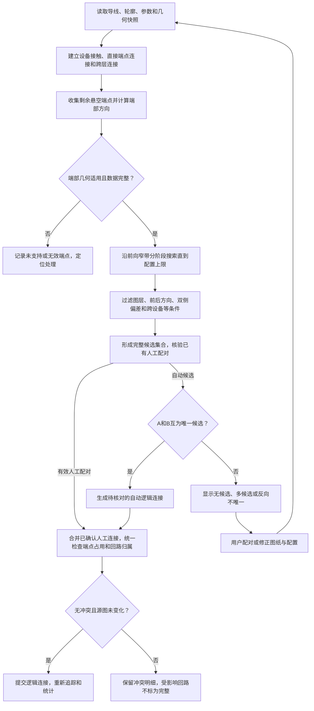

# 02 断线导线几何续接算法可执行方案

日期：2026-10-08

状态：G01—G04 源码及自动检查完成；G00 真实参数基线与 CAD 验证待执行，弧形断口专项支持未实现

版本：V0.3

所属总体方案：[01 应急照明回路统计与系统图生成方案](01_应急照明回路统计与系统图生成方案.md)。本文细化总体方案第 5.5 节，并作为 P02、P03 的实现依据；功率整数瓦、172W 上限、动态块系统图等业务仍由方案 01 管理。

## 2026-10-08 规则修订（优先于以下历史方案）

v10 按用户新要求实施：整条导线任一端接设备或配电箱，两端均排除；默认向前搜索 2000 mm；仅共线、相向、同高程；非共线交叉对象忽略；共线路径占用仍排除；双向唯一和回路隔离保留。端点和路径线段均建立平衡空间索引。断口偏差只留内部数值精度余量，不再供用户调整。

以下 V0.3 正文保留历史设计，关于近似共线、孤立端点可续接、轮廓横穿阻挡、逐级搜索和容差输入的描述已被本修订替代。当前操作与支持边界见 [03 加载使用与验收说明](03_加载使用与验收说明.md)，验证证据见 [v10 实施记录](../tests/evidence/2026-10-08-gap-rule10.md)。真实 CAD 验收仍待执行。

## 1. 已确定的目标和边界

用户采用手工打断方式处理管线交叉，每个断口长度不固定。本方案采用“方向搜索、近似共线、双向唯一匹配、回路归属核对”恢复统计所需的连接关系。

本方案严格保留以下规则：

1. 只建立逻辑连接，不执行延伸、合并、补画、删除或修改原图导线。
2. 交叉不连接，不实现 T 接；普通接线端点连接设备或配电箱边界。
3. 先识别设备、箱体、跨层引线及直接相接的导线，再对剩余悬空端点做断线续接。
4. 断口长度可以变化，但搜索范围有限。距离不是固定间隙，也不是单独的接线依据。
5. 一个端点最多配对一个续接端点；多个合理候选必须定位并交给用户配对。
6. 配电箱的各条种子出线保持独立；无法确定连接或归属时保留问题，不输出“完整且合格”的统计。
7. 不依赖句柄大小、句柄相邻、原实体句柄继承、打断父子关系或新设的专用打断命令。句柄仅用于定位当前实体。

适用的首版自动续接模型是同一 DWG 模型空间、同一平面内，`LINE` 或 `LWPOLYLINE` 的直线端部断口。多段线内部可以转折或含弧，判断使用断口所在端部，不以整条线的首尾连线作为方向。弧形断口、缺失拐角等不满足直线延续条件时明确列入问题，不套直线模型猜接。

几何上唯一的候选仍不是历史接线的证明；设计目标是在已确认的绘图规则和样图范围内可靠恢复，并暴露无法判断的情况，不承诺任意图纸百分之百自动恢复。

## 2. 与参考 LSP 的关系

参考：[FAS_topological_graphV2 - 副本.lsp](../参考/FAS_topological_graphV2%20-%20副本.lsp)。本次只读取参考文件，不修改它。

| 参考方法 | 可复用思路 | 本方案具体要求 |
| --- | --- | --- |
| `Line_LinkEnt_Select` | 从导线首尾端点检查连接 | 显式区分起点／终点及端部方向 |
| `Line_LinkCheck` | 正常连接找不到时向外搜索 | 改为有上限的端点候选搜索，不依赖固定断口宽度 |
| `LineSelect_EntCheck` | 图层、端点距离和方向过滤 | 检查两侧端点、双侧横向偏差和相向关系；允许直线与多段线互接 |
| `FAS_Circuit_Check` | 待检查列表与已访问集合 | 使用独立回路追踪；候选发现不因访问次序而改变 |

原 LSP 的 `BreakLine_Tolerance = 3000` 是沿端点向外的搜索长度，不是要求断口等于 3000。原实现围栏选择后再筛线，本方案将“框选到实体”和“确认端点可以配对”分开，以免把横穿线或远处不相关线路接入。

原实现的角度差需要特别核对 0／π 边界。本方案采用单位向量点积及叉积判定，避免仅用角度相减产生方向周期问题。

## 3. 输入、输出和端点身份

### 3.1 输入

| 输入 | 内容 |
| --- | --- |
| 图纸与处理范围 | 当前图纸身份、模型空间范围、配置导线图层；不得把当前屏幕可见范围当作数据范围 |
| 导线几何快照 | 实体句柄、类型、图层、全部必要顶点／弧段数据、平面信息、几何签名 |
| 端点记录 | 起点／终点标记、世界坐标、向外单位方向、端部类型、已建立的物理连接 |
| 设备和箱体轮廓 | 由方案 01 的轮廓模块提供，用于端点归类和检测间隙是否跨过设备 |
| 已确认连接 | 设备连接、直接端点连接、有效跨层引线配对 |
| 回路种子 | 本次配电箱的各条出线；箱体端口分别作为回路边界 |
| 参数与人工配对 | 本图参数快照、仍有效的人工断口配对 |

端点键采用 `(图纸身份, 实体句柄, start/end)`。实体只有一个句柄，但有两个不同端点；不能只按实体句柄标记端点已使用。几何变化、反转或实体替换后，必须核对端点和方向，不能盲目复用旧的 start/end 标记。

### 3.2 输出

| 输出 | 内容 |
| --- | --- |
| `LogicalConnection` | 两个端点键、`auto`／`manual` 来源、几何指标、参数版本、源几何签名 |
| `CandidateRecord` | 候选端点、间隙长度、双侧横向偏差、方向一致性、通过或拒绝原因 |
| `Diagnostic` | 无候选、多候选、反向不唯一、未支持端部、配对失效或回路归属冲突，均可定位 |
| 完整性状态 | 当前统计是否仍有未解决断点；与设备数量及功率校验分开 |

连接记录属于本图统计数据；人工配对保存在图纸对应的项目配置中。无需向原图实体写入 XData，也不改变原图线段。

## 4. 流程图



已有人工配对通过第 7 节检查后可直接进入全局核对，不要求继续满足“候选唯一”；这正是人工选择用于解决歧义的地方。没有人工选择时，所有自动连接必须满足双向唯一规则。

## 5. 几何判定

### 5.1 先区分普通接线与断口

- 端点接触设备、箱体或已识别引线时，交给原有角色逻辑处理，不再作为断口候选。
- 两根导线端点在接触容差内且归属明确时，先形成直接连接，不用正间隙公式处理零距离。
- 导线内部交点不创建连接。若一端终止于另一根导线中部，则报告 T 接／异常端点，不沿中部导线继续。
- 多个接触对象、重叠端点或重复导线先报告歧义，不任意消耗一个端点后再识别余下对象。
- 闭合多段线没有开放端点；本项目出现闭合候选时标记异常，不人为打开参与续接。
- 有效末端设备没有出线属于正常终点；没有设备接触且不能续接的裸端点属于未解决断点。

### 5.2 提取正确的向外方向

对于顶点顺序为 `p0, p1, ..., pn` 且端部为直线的导线：

```text
起点 p0 的向外方向 t0 = normalize(p0 - p1)
终点 pn 的向外方向 tn = normalize(pn - p(n-1))
```

`LINE` 使用其两个端点；`LWPOLYLINE` 使用断口端相邻的真实线段。坐标先统一到世界坐标；剔除用于求方向的连续重复点，若最终没有有效长度则返回 `INVALID_GEOMETRY`。内部转折不能改变端部方向。

若端部实际为弧段，即使能够取得切向，也不能按该切线无限延长来认定圆弧续接，返回 `UNSUPPORTED_END_GEOMETRY`。如 P00 样图中存在需要支持的弧形断口，应先在 G02 补齐同圆曲线延续的专项判据和样例，再计入验收通过；显式报告不支持不等于该必需场景已经完成。

### 5.3 直断口候选公式

设 A 的端点坐标为 `p`、向外单位向量为 `t`；B 的坐标为 `q`、向外单位向量为 `u`。所有计算在同一二维工作平面进行，平面外偏差单独检查。

```text
v  = q - p
L  = length(v)
gA = dot(v, t)
gB = dot(-v, u)
eA = abs(cross2(v, t))
eB = abs(cross2(-v, u))
c  = dot(t, -u)
```

其中 `cross2(a,b) = ax*by - ay*bx`。因方向向量已归一化，`eA`、`eB` 是端点到对方延长线的垂直距离。

一对端点进入几何候选集合，必须同时满足：

| 条件 | 判据 | 排除的情形 |
| --- | --- | --- |
| 合法端点 | 两者均为未连接的直线端部，且不属于同一实体 | 已接设备的端点、自连闭环、无效几何 |
| 图层允许 | 两侧位于配置允许的导线图层；首版默认同层，跨层组合需显式配置 | 建筑线和其他系统线 |
| 同一平面 | 平面外偏差不超过 `eps_z` | 投影重合但不在同一平面的对象 |
| 正间隙 | `eps_touch < L <= Dmax` | 已由直接接触模块处理的近零距离、超搜索上限 |
| 互在前方 | `gA > 0` 且 `gB > 0` | 身后端点、背向断口 |
| 双侧近似共线 | `eA <= eps_perp` 且 `eB <= eps_perp` | 附近平行线、端点错位 |
| 方向相向 | `c >= cos(theta_max)` | 横穿线、明显折角、同向断口 |
| 不跨越设备或接线终点 | 拟补的间隙内部不穿过需接入的设备／箱体／引线轮廓，也不跳过同路径的现有导线段或接线端点 | 直接跨过灯具或较近线路接到远处 |

“不跨越”针对需要接入的设备和同路径上已有线段。横穿拟补间隙的另一条导线属于允许的交叉，不因相交而配对，也不因相交就拒绝原回路续接。间隙内存在横穿线可用于解释识别结果，但不作为必需条件或连接证据。

阻挡检查针对拟补线段的开区间 `(A,B)`，排除两端已通过接触判定的端点本身。设备按已确认的接线轮廓检查；同路径导线按方向、横向偏差及在 A—B 方向上的投影重叠检查。区间中已有正长度的近似共线导线段，或有同路径的更近接线端点，就不能跳过它接向远端；非共线的中部交叉仍按“交叉不连接”处理。

对相邻平行回路，`eps_perp` 必须小于需要区分的实际横向间隔，并考虑绘图误差。若两者间距落入容差且无法区分，保持多候选状态，不通过扩大容差强行完成。

以上公式只能判定直线延续。若打断连拐角一起删掉，两端通常不共线，应报告无候选／几何不符，由用户配对确认缺失路径。

### 5.4 变长断口的有界搜索

1. 从本次配置范围一次性读取候选导线及所有端点，形成统一几何快照；不要只查询屏幕内可见对象。
2. 对端点 A，在向外方向建立长度 `Dmax`、半宽 `eps_perp` 的窄带。候选端点索引查询可使用该窄带的轴对齐包围框，再按第 5.3 节精确筛选。
3. 可以按 `R0, 2*R0, 4*R0, ..., Dmax` 分批收集候选。所有阶段只增加长度，不增加横向容差或角度容差。
4. 必须覆盖完整 `Dmax` 范围并完成去重，再作唯一性判断。发现近处候选时只记录，不能提前返回成功。
5. 候选按间隙长度、偏差及稳定端点键排序，仅用于展示和诊断；“最近”或“评分最高”不替代双向唯一。
6. 大于 `Dmax` 的断口先报告未解决，由用户调整配置后重跑或手工配对。算法不自行无限扩大搜索上限。

`R0` 是分批搜索的性能参数，`Dmax` 是允许搜索的上限，均不是规定的断口长度。同一组参数应能处理例如 20、75、180 个绘图单位等不同长度断口；具体允许范围由样图校准，示例值不代表项目默认值。

首版可以对完整端点集合逐一过滤以保证正确性；大图再加入网格或其他空间索引优化候选查询。优化后的候选集合必须与全量过滤一致，不能因为索引漏查而产生虚假的唯一候选。

### 5.5 双向唯一和端点占用

记 `C(A)` 为 A 在完整搜索范围内通过几何判据的候选集合。自动配对的必要条件为：

```text
C(A) = {B}
C(B) = {A}
```

例如 `C(A)={B}`，但 `C(B)={A,C}`，仍不能自动连接 A—B。否则遍历 A 还是 C 会影响结果。

先在未改变的几何快照上计算完整候选集合，再形成无向配对提案，并通过全局核对。禁止处理到 A 时立即占用 B、再删掉其他候选造成“后续看起来唯一”。同一端点最多属于一条最终逻辑连接；导线的另一端仍可连接另一段导线。

搜索不能用“已访问过”或“属于另一回路”提前隐藏几何候选；回路冲突应作为可见问题上报，不能排除冲突候选后自动改选其他端点。

## 6. 全局回路检查和逻辑连接提交

仅双向唯一还不足以保证多个回路不会被错误合并，须在逻辑连接参与计数前完成以下检查：

1. 建立包含原有物理连接和已确认跨层连接的基础图。箱体每条出线端口独立标记，不能用一个公共箱体节点把所有出线连通。
2. 收集所有自动配对提案和有效人工配对，一次性检查端点是否重复占用。
3. 将提案整体加入临时图，重新计算连通分量与出线种子归属。可以采用并查集或等价连通遍历，不按任意发现顺序决定哪条提案先“抢占”设备。
4. 同一连通分量包含两个及以上独立出线种子时，返回 `CIRCUIT_CONFLICT`。受影响分量内的提案保持未确认，列出相关出线、断口和设备，不能保留最后遍历到的一条作为正确答案。
5. 重复导线、异常分支、闭合回路、跨到其他箱体等，交给总体拓扑检查并保留定位信息。其他回路仍可显示统计，但整箱不能被标为识别完整。
6. 检查源快照是否变化；无冲突且源数据一致时，提交已通过的逻辑连接并重新追踪。统计阶段沿逻辑连接跨过断口，设备仍按实体身份去重。

逻辑连接不是 CAD 中新增的 `LINE` 实体。取消、失败或重新识别时，可直接撤销本次内存中的连接结果；持久化的人工配对另按来源校验。原始导线坐标、顶点、图层、句柄和数量均保持不变。

## 7. 人工确认与复用

### 7.1 人工配对与保存

无候选、多候选或无法唯一还原路径时，定位源端点并高亮候选，用户选择两个具体端点，而不是只点选两条多段线后让程序猜接哪一端。

| 场景 | 处理 |
| --- | --- |
| 多个符合几何条件的候选 | 显示距离、偏差和所属回路信息，由用户指定其中一对 |
| 无候选但用户确认存在断口 | 允许拾取另一端，显示超距离、非共线或端部类型等原因；用户显式确认后记录人工连接 |
| 源或目标已经接设备／被其他配对占用 | 不覆盖已有连接，先定位并解决占用问题 |
| 配对会合并两个独立出线回路 | 保持归属冲突，要求修正图纸或出线识别；不能用人工确认直接绕过 |
| 用户取消 | 保留未解决状态，不写入配对、不伪造完整统计 |

人工选择可替代唯一性判断，也可明确确认自动模型无法处理的间隙；但实体合法性、端点占用、处理范围、同平面和图层组合限制、全局回路隔离仍须通过。人工配对与自动配对在结果中明确区分。

配置保存：图纸身份、两端句柄及 start/end、坐标／方向／几何签名、确认日期、例外原因和配置版本。再次运行时重新读取整个相关搜索区域，检查是否新增导线或设备，而非只比较原来两段线是否还在。失效配对先停用并提示；删除、移动、反转、再次打断或改图层后不能直接沿用。

跨层引线配对仍使用方案 01 的独立角色流程。不能因为空间距离很远，就将普通断口自动判为跨层连接。

### 7.2 独立的单断口高亮测试入口

已提供命令 `ELGAPTEST` 源码，用于“拾取打断导线的一段 → 查看算法找到的另一段”。它是 G02 阶段的独立交互入口，不必等到整箱统计或系统图生成完成后才能测试。几何内核已通过合成自动检查；真实 CAD 加载、临时高亮及视图恢复仍待验收。

最小操作流程：

1. 加载插件后运行 `ELGAPTEST`，提示“请选择打断导线的一段，靠近要检查的断口点击”。
2. 高亮选中的源导线，并在距拾取位置较近的端点显示标记 A 和向外方向箭头。拾取位置到两端距离接近、无法明确选择时，要求点选端点；提供“换端点”选项。选到已连接设备的端点时显示“该端已连接”，不静默切到另一端。
3. 复用本方案的完整范围候选筛选和双向唯一判据；虽然只展示一个断口，仍要核对另一端的完整候选集合，不能只在 A 附近找到 B 就报成功。
4. 找到双向唯一的几何匹配时，同时高亮另一段整条导线，并标记目标端点 B；在 A—B 间显示临时虚线，直观看出拟续接的位置。
5. 显示简短结果，例如“找到 1 对双向几何匹配；断口长度 75 个绘图单位；整箱回路归属未核对”。“详情”中再显示两段句柄、端点、双侧偏差、角度差和参数。
6. 用户可继续“下一处”“换端点”“参数”“定位结果”“详情”，或按 Esc 退出。切换测试对象、退出、取消或失败时清除本次临时图形和高亮，并恢复进入命令前的相关状态。

建议显示规则如下；颜色用于临时显示，并辅以端点标记和文字，不能只凭颜色判断状态：

| 结果 | 直观显示 | 文字含义 |
| --- | --- | --- |
| 源导线 | 青色临时轮廓／高亮，端点 A 和方向箭头 | 正在检查哪一段、哪一端 |
| 双向唯一几何匹配 | 目标导线绿色临时轮廓／高亮，端点 B，间隙临时虚线 | 几何匹配成立；回路归属检查状态另行显示 |
| 多候选或反向不唯一 | 候选导线黄色临时轮廓／高亮，标记 B1、B2 等 | 存在歧义，不能自动认定；反向竞争端点也可定位查看 |
| 无候选、端部不支持或连接冲突 | 源端点红色临时标记，并显示原因 | 本处未能自动续接；可查看搜索方向、范围和拒绝明细 |

测试可以在一个最小样例中进行：画一条直线或直端多段线，手工打断，运行命令点选其中一段，确认另一段是否高亮；改变断口长度、加入横穿线或邻近平行线后再次测试。测试使用与正式识别相同的几何函数，不另写一套仅供演示的续接算法。

配置与结果边界：

- 有效图层和角色配置存在时直接复用；缺少配置时，可用所选导线图层作为本次临时导线层进行几何试查，不自动保存为正式配置。
- 缺少设备／箱体／引线角色信息时，结果注明“仅几何试查，设备阻挡与角色排除未核对”；没有箱体种子上下文时注明“回路归属未核对”。不得把局部高亮结果写成整箱识别通过。
- 已具备完整上下文时，沿用第 6 节的全局检查并显示检查结果。单断口测试入口始终只做预览，不提交正式拓扑结果、不保存人工配对、不触发统计或系统图生成。
- 临时虚线不是新增到 DWG 的导线。高亮和颜色使用临时图形／显示机制实现，不通过修改实体颜色、图层或几何实现，退出后不留下绘图对象。
- 默认不改变视图范围；另一端在屏幕外时提供“定位结果”显示源端与目标端，退出时恢复命令修改前的视图。人工确认和配对保存继续使用第 7.1 节的明确操作流程。

## 8. 参数和错误状态

### 8.1 参数表

| 参数 | 含义 | 校准要求 |
| --- | --- | --- |
| `eps_touch` | 普通端点接触容差 | 从正常接线误差确定，须小于需要作为断口处理的距离 |
| `eps_perp` | 双侧横向偏差上限 | 根据端点误差和相邻回路间距确定，不随搜索长度增长 |
| `theta_max` | 相向方向的角度容差 | 取小于 π/2 的非负角度，直线打断样例中应接近共线 |
| `eps_z` | 工作平面偏差上限 | 防止不同平面投影误连 |
| `R0` | 初始搜索长度 | 满足 `0 < R0 <= Dmax`；只影响查询分批 |
| `Dmax` | 最大自动搜索距离 | 大于 `eps_touch`，参考实际最大断口并保存配置，不自动无限扩大 |
| 图层组合 | 允许相互续接的导线图层 | 首版默认同层，用户明确配置的组合须对称 |

所有参数须为有限数，长度容差为非负且满足以上约束。图纸几何容差使用绘图单位，与设备功率的 1W 精度无关。世界坐标很大时先使用相对坐标计算；浮点误差保护采用独立且固定的数值容差，不能暗中放大业务容差。

参考 LSP 中的线端容差 5、块范围扩展量 36、搜索长度 3000、角度 0.035 弧度可作为样图核对起点。块轮廓扩展量不能直接当作横向偏差，3000 也不直接当作本项目已经验证的默认值。

### 8.2 诊断状态

| 状态 | 含义 |
| --- | --- |
| `NO_CANDIDATE` | 在搜索上限内没有满足条件的端点 |
| `AMBIGUOUS_CANDIDATES` | 当前端点有多个合理候选 |
| `NOT_MUTUALLY_UNIQUE` | 当前端点唯一，但另一端不唯一 |
| `INVALID_GEOMETRY` | 零长度、不可用坐标、重复退化几何等 |
| `UNSUPPORTED_END_GEOMETRY` | 弧形断口等尚未实现自动模型的端部 |
| `BLOCKED_BY_DEVICE_OR_PATH` | 候选间隙跨过设备或同路径已有接线对象 |
| `ENDPOINT_OCCUPIED` | 两条提案争用同一端点或端点已经物理连接 |
| `CIRCUIT_CONFLICT` | 续接导致多个独立出线种子连通 |
| `STALE_PAIR` | 人工配对与当前源实体或周边几何不一致 |
| `SOURCE_CHANGED` | 查询到提交之间源图发生变化，需重建快照 |

诊断应保存拒绝依据，不能统一显示成“没有找到设备”。涉及当前箱体回路的未解决诊断阻止其被标为完整；处理范围内完全无关的孤立线作为单独问题展示，不能因它存在就假报当前箱体断线。

## 9. 实现接口和伪代码

沿用方案 01 的模块分工，不另建一套设备统计或回路注册机制。

| 已实现函数 | 所属模块 | 输入 → 输出 |
| --- | --- | --- |
| `EL:CollectEndpointSnapshot` | `src/geometry.lsp` | 导线及角色配置 → 端点、方向、几何签名 |
| `EL:FindGapCandidates` | `src/geometry.lsp` | 端点快照、参数、轮廓 → 完整候选表及拒绝原因 |
| `EL:ValidateGapPair` | `src/geometry.lsp` | 两端点 → 双侧距离、方向及阻挡检查结果 |
| `EL:BuildMutualPairs` | `src/topology.lsp` | 完整候选表 → 无向自动配对提案 |
| `EL:ValidatePairSet` | `src/topology.lsp` | 基础图、全部提案、出线种子 → 合格连接和冲突分量 |
| `EL:ResolveGapManually` | `src/main.lsp`、`ui/` | 诊断及候选 → 人工配对或取消 |
| `EL:LoadValidGapPairs` | `src/config.lsp` | 本图配置、新快照 → 有效人工配对及失效项 |
| `c:ELGAPTEST` | `src/main.lsp` | 拾取导线与端点 → 调用共用几何判据，显示本处结果，不提交连接 |
| `EL:ShowGapPreview`、`EL:ClearGapPreview` | `src/main.lsp`、`ui/` | 源端、候选和诊断 → 临时高亮、端点标记及清理；最小版先用命令行交互 |

```text
snapshot = collect_drawing_geometry_and_roles()
base_graph = build_physical_and_leader_connections(snapshot)
ends, endpoint_issues = classify_open_endpoints(snapshot, base_graph)
manual_pairs, stale_issues = validate_saved_pairs(snapshot, base_graph)

candidate_map = empty_map()
for A in ends:
    if A is invalid or automatic model is unsupported:
        record endpoint diagnostic
        continue
    candidates = query_all_stages_up_to_Dmax(A, snapshot, config)
    candidate_map[A] = all B passing validate_gap_pair(A, B)

proposals = valid manual_pairs
for A in ends:
    if A is claimed by a valid manual pair:
        continue
    if A is invalid or automatic model is unsupported:
        continue
    if candidate_map[A] contains exactly B
       and candidate_map[B] contains exactly A:
        if B is claimed by another manual pair:
            record ENDPOINT_OCCUPIED
        else:
            add unordered pair(A, B) to proposals once
    else:
        record NO_CANDIDATE / AMBIGUOUS_CANDIDATES / NOT_MUTUALLY_UNIQUE

accepted, conflicts = validate_all_pairs_together(base_graph, proposals, seeds)
if drawing snapshot is stale:
    discard provisional result and record SOURCE_CHANGED
else:
    apply accepted pairs to logical graph only
    retrace each seed and recount devices by entity identity
    attach diagnostics to affected circuits
    allow complete result only when all required connections are resolved
```

人工配对占用不用于缩减其他端点的原始候选集合，避免产生虚假唯一；相关竞争端点会保留诊断供核对。所有临时变量局部化，取消或异常返回统一释放临时显示并恢复修改过的 CAD 系统变量。

## 10. 实施顺序和退出条件

| 编号 | 工作 | 依赖 | Agent 工作 | 用户参与 | 退出条件 |
| --- | --- | --- | --- | --- | --- |
| G00 | 样图和参数基线 | 方案 01 的 P00、P01 | 读取真实断口、图层、几何类型和相邻回路间距，建立人工真值及配置 | 核对哪些端点原本相连 | 有不同长度断口及误连反例；明确自动支持边界 |
| G01 | 端点快照和分类 | G00 | 实现坐标转换、端部方向、物理连接排除、无效几何诊断 | 核对代表性端点 | 起终点方向正确，末端设备与裸断点区分正确 |
| G02 | 完整候选和双向配对 | G01 | 实现窄带查询、几何判据、双向唯一及顺序无关提案，并交付第 7.2 节的单断口高亮测试命令；需要时补弧端专项模型 | 点选一段导线，核对另一段高亮及歧义展示 | 可独立测试变长断口；已支持样例连接正确、交叉不误接；必需样例无静默漏算 |
| G03 | 全局核对和统计接入 | G02、方案 01 的多出线种子机制 | 批量校验端点占用及回路归属，接入原有回路追踪 | 核对各出线数量 | 不串路、不重计、冲突可定位、原图不变 |
| G04 | 人工配对、复用和集中验证 | G03 | 配对交互、失效检查、自动用例、必要性能优化和 CAD 验收记录 | 配对疑义断口并核对一轮代表样图 | 保存重开可用，失效不静默复用，验收矩阵有实际证据 |

G00 已提供合成 JSON／DXF 基线；G01—G04 已提供源码和相应自动检查。进展见 [实施与验收状态](../tests/evidence/implementation-status.md)。真实参数、CAD 实体、轮廓及显示交互仍待样图验收，不能将源码交付记为全部退出条件已满足。

## 11. 验收矩阵

以下为验收目标。已执行的自动部分与尚待 CAD 部分见 [证据映射](../tests/evidence/implementation-status.md)，不能将合成检查视为 CAD 全部通过。数值样例使用人工坐标单位，须再按真实图纸单位校准。

基准自动用例可固定 `Dmax=200`、`eps_touch=0.1`、`eps_perp=0.5`、`theta_max=0.01` 弧度。以 A=`(0,0)`、向外方向 `(1,0)`，B=`(d,0)`、向外方向 `(-1,0)` 构造断口；两个端点来自不同实体。以下单项修改参数时须记录，不能混用测试配置与生产默认值。

| 编号 | 样例／操作 | 预期 |
| --- | --- | --- |
| AG01 | 同一配置下分别取 `d=20,75,180` | 三种长度均可自动配对，无固定断口长度假设 |
| AG02 | `d=200`、`d=201`，分别执行 | 前者在上限内，后者不自动连接 |
| AG03 | A—B 间隙中有一条竖直横穿线，端点远离间隙 | A—B 正常配对，横穿线不加入原回路 |
| AG04 | 两条完整导线中部相交，或存在 T 形端点 | 交叉不连接；T 形按异常报告，不走分支 |
| AG05 | B 偏移到 `(75,2)`；或方向改为 `(1,0)` | 分别因横向偏差、背向关系拒绝 |
| AG06 | A、B 接近方向角 0／π 的边界，整体旋转相同角度 | 与未旋转样例结论一致 |
| AG07 | A、B 几何匹配，但 B 还有另一个未被路径阻挡的合理候选 C | 不自动接受 A—B，报告反向不唯一 |
| AG08 | 用长间隙配合微小角差构造另一合理候选，令其在外层查询才出现 | 查完整范围后报告歧义，不因内层先找到候选而提前通过 |
| AG09 | 随机打乱实体顺序、端点顺序和回路种子顺序 | 自动连接集合和诊断集合一致 |
| AG10 | `LINE` 与直端 `LWPOLYLINE` 互接，多段线内部含多个拐角 | 按端部方向连接，允许实体类型不同 |
| AG11 | 零长度线、连续重复点、闭合多段线、不同平面 | 退化项诊断；重复点仅在可恢复有效方向时处理；闭合和不同平面不误接 |
| AG12 | 弧形断口，或删除了拐角的断口 | 不套直线模型自动连接；需要支持的弧端必须另有专项通过证据 |
| AG13 | A—B 间有设备、配电箱或同路径更近的导线段 | 不越过对象直接连接远端；普通横穿线不按此阻挡 |
| AG14 | 两个独立出线种子经唯一候选提案连通 | 整体核对发现归属冲突，受影响提案不确认为有效 |
| AG15 | A—B、B—C 等提案争用同一端点 | 报告占用冲突；不按遍历顺序择一 |
| AG16 | 人工选择多候选中的一对；取消另一处配对 | 记录手工来源及检查依据；取消处仍未解决 |
| AG17 | 保存重开、移动／反转一端、删除一端、插入新干扰线 | 未变配对可复用；变更后重新核对并停用失效配对 |
| AG18 | 连续多个不同长度断口后接末端设备 | 每个端点仅配对一次，全部设备按实体只计一次 |
| AG19 | 比较全量端点扫描与空间索引结果；改变视图缩放 | 候选集合一致，不能因离屏或索引漏查产生唯一候选 |
| AG20 | 运行前后比较原图实体数量、句柄、坐标、顶点、图层，测试取消和失败 | 原图导线无修改，临时显示和系统变量恢复 |
| AG21 | 一回路仍有疑义，其他回路识别成功 | 可查看已得明细，但整箱不标记识别完整，不能生成正式系统图 |
| AG22 | 运行 `ELGAPTEST`，在断口附近拾取一段导线 | 源端点和方向明确，匹配的另一段整条高亮，间隙显示临时虚线；只显示局部结果，不统计整箱 |
| AG23 | 在同一导线两端分别拾取，或用“换端点”切换 | 清理上次显示并检查指定端点；端点已连接时如实提示，不擅自改选另一端 |
| AG24 | 分别构造多候选、反向不唯一和无候选，再运行单断口测试 | 候选及竞争端点可定位；显示歧义或失败原因，不把首个候选标为确定结果 |
| AG25 | 单断口测试中继续下一处、Esc 退出、触发异常或定位离屏目标 | 临时图形和高亮正确清理，修改过的视图／状态恢复；DWG 无新增或修改实体，配对配置不变 |
| AG26 | 缺少设备角色配置或箱体种子，完成单断口几何试查 | 可以查看几何候选，同时明确显示未完成的角色／回路检查；不宣称完整识别通过 |

证据保存到 `tests/evidence/`，包括日期、样图或合成数据版本、参数快照、人工真值、实际配对和拒绝原因。先执行自动几何及图遍历用例，再集中进行 CAD 操作和视觉核对。

## 12. 交付边界

当前已交付算法源码、`ELGAPTEST`、人工配对、全局隔离、统计及模板生成入口；40 项自动检查通过并保存源码指纹。独立高亮命令复用正式候选内核，读取完整模型空间快照、按全量扫描筛选，不实现空间索引或弧端专项延续。真实 CAD 加载、配对重开、显示清理及图纸不变性仍待 [集中验收](../tests/evidence/cad-acceptance.md)，保持“识别 → 统计 → 功率 → 动态块系统图”流程及所有未满足条件。
