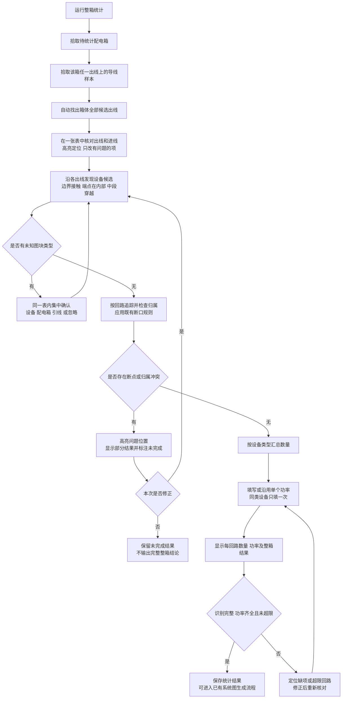
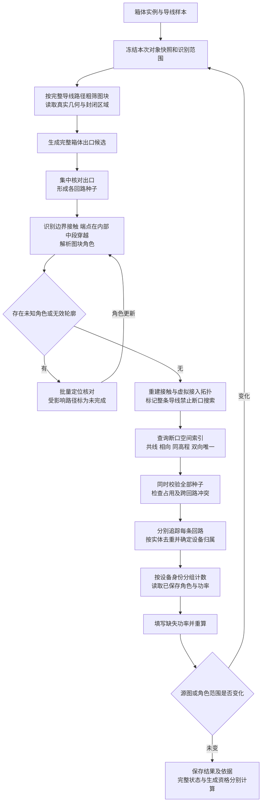

# 04 整箱自动分回路统计与设备功率赋值可执行方案

日期：2026-10-08
状态：B01—B05 已实施；B06 自动验证与打包完成，真实 CAD 验收待执行

> 2026-10-08 v19 实施更新：用户已确认按图块整体包围盒识别，导线中段穿过也算接入。当前接线识别不展开内部几何，内部孔洞与凹口不扣除。以下原方案中的“真实轮廓、孔洞、定义内容签名”属于历史设计，当前行为以 `03_加载使用与验收说明.md` 和 `tests/evidence/2026-10-08-whole-block.md` 为准。真实 CAD 性能待复测。

版本：V1.2（保留 V1.1 设计要求，补充实施状态）
代码基线：`7288d2d`（AutoCAD 2020 交付包 010）

## 1. 目标与已确定的操作

用户先拾取待统计配电箱，再拾取该箱任一出线上的一段导线。程序以配电箱为范围边界，以导线为识别样本，自动发现该箱全部出线并分别追踪回路，汇总设备数量，再按设备类型填写单个功率。

**不要求逐条拾取回路，不要求预先逐种录入全部设备，不对每条出线依次弹出 Yes/No。**正常流程为“两次拾取、集中核对、按类型填功率”。只对缺少识别范围、未知对象或有歧义的接线请求补充操作。

本方案替代方案 01 中必须预先采样设备图层、逐条确认出线的入口设计；方案 01 的整数瓦、172W、真实模板和结果有效性要求继续保留。方案 02 的 2026-10-08 修订及 v10 断口规则继续生效。现有命令的实际使用方法仍以方案 03 为准，本文描述待实施的目标行为。

## 2. 用户操作流程图

补充：未完成回路也可以展示已发现设备并预填功率，但不能据此标为完整或将部分负载冒充整箱总负载。几何问题返回追踪阶段；功率缺项返回功率表，二者分别处理。

## 3. 两次拾取的含义与范围

| 拾取项 | 程序记录 | 处理要求 |
| --- | --- | --- |
| 配电箱 | 当前实例句柄、块身份、图层、真实轮廓、所在图纸 | 本次整箱统计的根对象；不是普通负载，不通过箱体连接不同出线 |
| 导线样本 | 当前实例、类型、图层、端点及其与所选箱体的关系 | 提供导线识别范围；不是只统计该样本所在的一条回路 |

1. 入口接受模型空间中支持的配电箱图块和 LINE／开放 LWPOLYLINE。无效对象就地提示重新选；取消则结束，不改图。
2. 优先提示选靠近箱体、确实属于出线的一段导线。若无法验证样本与所选箱体的关系，明确提示核对，不把远处独立导线直接当作该箱回路。
3. 导线样本图层作为默认范围，兼容已保存且本次有效的其他导线图层。提供一个“补充导线图层”入口；一次补充样本作用于整箱，不要求逐回路采样。
4. 一个样本不能证明全图所有导线均在同一图层。界面显示实际采用的图层；发现箱边其他未纳入图层的线端时提示补充或明确排除，存在未解决候选时不宣称整箱完整。
5. 不以当前屏幕可见范围为数据范围，不将全图所有设备直接计入所选配电箱。
6. 设备候选按连接关系发现，不能继续以预先采样的设备图层作为硬性白名单，否则会漏掉用户未录入的类型。

## 4. 自动发现出线并隔离各回路

### 4.1 箱体边界与回路种子

读取所选箱体实际轮廓，查找与其边界相接、向箱外延伸的候选线端，每个独立出口形成一个候选回路种子。种子记录箱体、导线句柄、端点侧及接入点，去重规则依据几何和实体身份，不依据发现次序。

完整候选集合只在一张表中显示。用户可统一确认，或取消进线、备用非出线、误识别对象；选中表格行即高亮该出口。已确认且源图未变化的出线选择可以复用。

**几何相接本身不能可靠区分进线与出线。**导线样本可确认其中一个出口属于目标出线范围，但不能代替其他出口的进出线判断。没有可靠既有标记的候选应标为待核对，由用户集中确认；不得按距离、句柄或“第一根”猜测进线。此处集中核对不等于要求用户逐根在图上拾取。

### 4.2 回路归属

- 每个确认出线拥有独立的追踪状态和对象集合；不得因某回路先访问对象就吞并另一个回路。
- 所选箱体作为边界，不在拓扑图中充当连接全部出线的普通节点。
- 遇到其他配电箱停止穿越并报告，不将另一箱体后面的设备计入当前箱。
- 两个种子到达同一设备或同一条路径时报告归属冲突，不重复计数，不自动合并成一条回路。
- 导线之间普通交叉不连接；导线中段穿过设备按第 5.2 节识别设备连接。T 接、多端口、闭合线路按现有支持边界诊断，不默认扩展为已支持分支。
- R1、R2 等编号按稳定规则生成，展示其出口位置；重新扫描的顺序变化不能随机改变回路身份。

## 5. 自动发现设备与记忆分类

### 5.1 发现与确认分开

程序对模型空间图块建立粗筛索引，再沿已纳入范围的整条导线查找相接图块，覆盖端点和中间各段，不能只查询端点附近。包围盒仅用于缩小范围，是否接入按真实几何与内部区域判断；满足第 5.2 节连接条件的图块进入设备候选。

已选箱体及可靠已知角色直接复用；未知块型按身份汇总到同一张核对表中，定位一类即可看见各实例。用户确认一次类型，应用于本次相同身份对象。未知角色不直接当作负载，也不直接作为导电节点穿越。

| 角色 | 计入负载 | 追踪行为 |
| --- | --- | --- |
| 设备 | 是，功率确认后计算 | 只有一个接入端时为末端；两个明确接入端时可沿另一侧继续；多端口或歧义需要处理 |
| 配电箱 | 否 | 作为回路边界；所选箱体用于发现出口，其他箱体停止穿越 |
| 跨层引线 | 否 | 只有已明确配对且仍有效的关系允许跨接，沿用现有引线校验 |
| 忽略对象 | 否 | 不当成连接节点；不能因为忽略该块就自动把它两侧导线短接 |
| 未知／不支持 | 暂不计 | 显示待核对或未完成，不能得出完整回路结论 |

同名设备可能有不同动态状态或定义。继续使用“有效块名 + 动态状态 + 定义签名”区分身份，不只按块名合并功率；不同实际接入方式也不能因名称相同而强制贯通。

### 5.2 设备与导线连接判定

已确认角色为设备的图块，以下三类均视为与导线连接，自动纳入回路追踪和设备统计，不要求用户逐个确认连接点：

| 连接情形 | 判定要求 | 处理结果 |
| --- | --- | --- |
| 导线端点接触设备几何 | 端点与有效设备几何相接，沿用端点接触的微小数值容差 | 记录设备与导线连接 |
| 导线端点位于设备内部 | 端点落在设备真实封闭区域内，即使离所有几何线条都较远 | 同样记录连接，不再要求端点靠近轮廓线或内部线条 |
| 导线中段穿过设备 | 导线实际路径进入设备真实封闭区域，即使两个端点都在设备外 | 同样记录连接；沿原导线继续追踪，并统计该设备 |

内部区域由图块有效封闭外轮廓及明确的孔洞边界确定，并应用实例的平移、旋转、缩放和嵌套变换。包围盒只作粗筛，不能用包围盒或凸包代替真实区域；凹形轮廓的空缺、明确孔洞及图块周围空白不算设备内部，内部装饰线也不自动作为孔洞边界。无法可靠建立封闭区域时，已有明确几何接触仍可识别；仅凭“在包围盒内”或包围盒相交的情况列为待核对，不猜测连接。

三类判定均须核对导线与设备所在平面／高程，二维投影重叠而高程不同不算连接。LINE 检查整段，LWPOLYLINE 检查全部实际直线段和圆弧段，不能只用首尾连线或外包矩形判断穿越。这里的设备接触与断口续接是两种规则：导线穿过设备无需与设备轮廓共线，2000 mm 搜索范围也不用于扩大设备连接范围。

中段穿越通过内存中的虚拟接入点或接触区间接入拓扑图，必要时只拆分拓扑边，不打断、重画或修改原 CAD 导线。沿同一条导线可以继续到设备另一侧；不同导线不能仅因相互交叉就短接，若它们都接入同一设备，仍须检查设备端口数和回路归属，多端口或跨回路冲突不能自动合并。

同一设备实例被多个线段、接入点或穿越区间命中时按实体句柄去重，只统计一次；不同设备实例仍分别计数。配电箱继续执行第 4 节的出口与边界规则，不能将设备贯通行为套用到箱体，造成不同出线互连。

### 5.3 与断口规则的衔接

设备角色会影响哪些导线允许搜索断口，因此不能先把未知图块全部忽略、做完续接后再补分类。未知角色可能接触到的导线先标为待核对；分类完成后重新计算物理接触、整条导线排除和断口候选，不沿用分类前的临时配对。

保留已确认的 v10 断口几何规则，并将整条导线排除条件扩展到上述连接情形：

- 同一条 LINE/LWPOLYLINE 任一端接了设备或配电箱，整条对象两端均不参与断口搜索，也不作为候选；端点位于设备内部或中段穿过设备同样触发整条对象排除，不能因两个端点悬空而继续搜索。
- 该限制只作用于跨断口续接，不禁止沿正常导线与设备实际连接追踪。
- 未接设备的自由导线向断口外伸方向搜索，默认 2000 mm，仅共线、相向、同高程；只保留内部浮点数值精度余量。
- 非共线交叉线忽略；实际共线路径占用仍阻止跨越。双方互为唯一候选才自动配对。
- 端点及路径空间索引继续复用。不能为凑齐整箱设备而放宽规则、绕过箱体边界或自动选最近候选。
- 被该规则阻断的回路显示未完成，并定位断口，不承诺任意图纸都能自动找到所有设备。

## 6. 内部识别流程图

## 7. 汇总与功率表

同一窗口提供“回路列表”和“设备功率表”两个区域：

| 区域 | 必须显示 | 交互 |
| --- | --- | --- |
| 回路列表 | 编号、出口位置、设备数量、当前功率、完整／未完成／冲突、超限状态 | 点一行高亮整条回路；有问题时可定位具体对象 |
| 设备功率表 | 设备名称、类别、身份差异提示、数量、涉及回路、单个功率、小计、数值来源 | 同类填一次；点一行高亮对应实例，可只看当前回路 |

示例显示值仅作界面说明，不作为默认设备库：照明灯 A 共 8 个、单个 5W、小计 40W；出口标志 B 共 3 个、单个 1W、小计 3W。各回路按实际实例归属分别计算，整箱表只汇总，不丢失回路对应关系。

功率使用整数 W；本次明确输入优先于本图保存值，再优先于项目设备库。类别已确认后可提供既有建议值，未知类别不直接赋默认功率。0W 需明确确认用途。已保存值有效时直接沿用，首次缺项才要求填写。

按设备身份保存角色与功率，区分“本图使用”和“保存到设备库”；角色、功率必须经过用户确认才持久化。不能把首个实例的一次临时判断静默推广到定义或动态状态不同的全部同名块。

未完成回路展示当前已发现设备与部分功率，但不并入“完整回路合计”；整箱仍存在未完成或冲突时，不显示完整整箱结论。每回路 171W／172W 合格、173W 超限的既有检查继续保留。

## 8. 实施步骤与代码落点

以下 B01—B06 为本方案增量步骤，不替换原 P00—P06、G00—G04 编号；每步先复用现有实现，再补缺项。

| 步骤 | 具体工作 | 复用与修改位置 | 完成条件 |
| --- | --- | --- | --- |
| B01 入口与范围 | 拟将 ELSTAT／ELTRACE 入口改为先箱体、后导线样本；校验关系；允许补充图层；去掉逐出线 Yes/No | `src/main.lsp` 的命令入口、`src/config.lsp` 的采样和配置 | 两次正常拾取即可建立整箱任务；无效／取消均可结束；现有配置不被清空 |
| B02 候选与角色 | 将设备图层白名单改为连接关系候选；查询整条导线；新增封闭区域内点、实际路径穿越判定；未知身份集中核对 | `EL:CollectEndpointSnapshot`、`EL:BlockRecord`、`EL:Role`、`EL:Touches` 及新增区域／路径几何函数；新增角色映射读写 | 未采样设备层也可发现；内部端点和中段穿越均识别；包围盒空白不误接；未知角色不能虚报完整 |
| B03 整箱出线与追踪 | 复用箱边种子发现，增加集中候选表和进线排除；分类后重建接触与虚拟接入拓扑；三类设备连接均排除整条导线的断口搜索；同时核对所有回路 | `EL:SeedCandidates`、`EL:BuildPhysical`、`EL:AnalyzeSnapshot`、`EL:TraceCircuit` | 同箱多回路自动分开；中段接入不改原图且设备不重复计数；不穿过箱体串线；v10 断口几何规则不回退 |
| B04 分类计数与功率 | 复用设备身份、数量和功率优先级，增加回路筛选、整类高亮、批量确认和明确保存动作 | `src/statistics.lsp`、`EL:PowerDialog`、`ui/power.dcl` 或独立 DCL | 多种设备只按类型赋值；同名异状态不误合并；功率改动只重算统计 |
| B05 有效性与持久化 | 增加角色映射、箱体出口选择和规则版本；迁移旧配置；源图／范围／角色变化后失效重算 | `EL:ConfigValid`、`EL:RecognitionRules`、`EL:SourceCurrent`、设备库校验 | 不覆盖旧功率／模板；未确认数据不写入；陈旧识别结果不能生成 |
| B06 验证与交付 | 定向自动回归、真实 DWG 核对、菜单与高亮实测、GB2312 构建 | `tests/`、`tools/build_cad2020.py`、方案 03 | 分别记录自动证据与真实 CAD 证据；按序号生成后续交付包 |

配置实现约束：现有 `EL:OnlyKeys` 对配置和设备库执行字段白名单校验。新增角色映射和箱体出口选择时，必须同步升级模式版本、校验器、迁移与测试，不能直接往旧记录塞入未注册字段。现有功率身份可复用，但角色数据不应混入整数功率字段。

结果最少保存：图纸身份、箱体句柄、导线范围、对象快照签名、角色映射版本、已确认出口集合、各回路设备与问题、功率配置依据。缓存必须随实体增删改、动态状态、图层范围或角色变更失效；只修改功率可复用仍有效的识别结果。

## 9. 验收场景

| 编号 | 输入或操作 | 必须得到的结果 |
| --- | --- | --- |
| A01 | 同箱 3 条出线，仅拾取箱体及其中 1 根导线 | 自动发现全部出口并按 3 条回路统计，不要求另点 2 根出线 |
| A02 | 箱边另有一条进线 | 集中表可一次排除进线；未确认时不把它默认为负载回路 |
| A03 | 同箱出线分布在两个导线图层 | 显示实际范围，可补充一次样本覆盖第二图层，不因初始样本层而宣称无遗漏 |
| A04 | 多种设备分布在未预采样的图层 | 沿连接发现；已知身份复用，未知身份按类型集中确认 |
| A05 | 无关建筑图块靠近或横穿线路 | 粗筛不等于设备认定；忽略对象不导通两侧导线 |
| A06 | 设备一进一出、单端末端及多端口 | 前两类按实际接线追踪；多端口保持问题状态，不猜接 |
| A07 | 路径到达其他配电箱 | 停止穿越并报告，不计入该箱后方设备 |
| A08 | 两条种子回路到达同一设备／路径 | 报归属冲突，不靠访问顺序分配，不重复计数 |
| A09 | 整条线一端接设备，另一端悬空 | 不参与自动断口搜索；回路因此中断则标为未完成 |
| A10 | 未接设备的共线相向断口、非共线横穿、多个候选、超过 2000 mm | 分别按 v10 匹配、忽略横穿、保留歧义、默认不跨上限；允许显式调整范围 |
| A11 | 同型 20 个设备，同名不同动态状态设备 | 同型只填一次；不同身份分组；点表格行定位正确实例 |
| A12 | 已保存功率、自定义功率、未确认类别、0W | 按优先级复用；缺项不假定为 0；0W 要明确确认 |
| A13 | 回路为 171W／172W／173W | 前两者功率合格，173W 标超限；与拓扑完整性分别显示 |
| A14 | 识别途中取消、源图修改、角色变更后返回 | 清理高亮；不保存半成品为完整结果；必须重建受影响识别 |
| A15 | 旧配置及旧配对迁移 | 采样／功率／模板保留；不兼容配对明确失效，不能静默继续使用 |
| A16 | 小图和代表性大图 | 记录采集、轮廓解析、接触、候选、追踪各阶段耗时和数量；分别比较结果与性能 |
| A17 | 导线端点在设备真实封闭区域内，离所有几何线条均超过端点接触容差 | 自动识别连接并计入设备；整条导线两端均排除断口搜索 |
| A18 | LINE 或 LWPOLYLINE 中间某段穿过设备，两个端点都在外 | 自动识别连接，沿原导线继续追踪；整条导线排除断口搜索；CAD 实体不被打断或改写 |
| A19 | 导线只穿过图块包围盒空白、凹形空缺或明确孔洞；轮廓无法闭合 | 前三类不按内部或穿越误接；无法确认区域且无明确几何接触时标为待核对 |
| A20 | 同一设备被同一条多段线多次进入，或同时命中端点与中段 | 接触记录合并，设备实例只计一次；整条导线排除断口搜索 |
| A21 | 两条独立回路穿过同一设备，另有两条导线只在设备外相交 | 前者报告归属冲突且不重复计数，不自动合并回路；后者不因交叉而连接 |
| A22 | 旋转、缩放、嵌套设备，以及圆弧段穿越；另设投影重叠但高程不同的对照 | 按变换后的实际区域和导线路径识别；不同高程不误接；不能用圆弧弦线代替实际路径 |

测试策略：使用现有 AutoLISP 宿主做入口、配置、拓扑与功率回归；用实际样图核对箱边出口、设备轮廓、动态块身份、回路高亮和遗漏情况。图块粗筛索引应延迟昂贵轮廓解析，但不能以省时为由漏掉候选。没有真实图纸测量前不承诺固定秒数。

## 10. 当前实施状态

日期：2026-10-08。状态：源码及自动验证完成；真实 CAD 验收未完成。

| 步骤 | 提交 | 实施内容 |
| --- | --- | --- |
| B01 | `3961e6d` | 两次拾取、范围补充及集中出口入口 |
| B02 | `2582693` | 整线图块候选、真实闭合区域与路径判定、角色表及模式字段 |
| B03 | `4c922b1` | 中段接入、整条导线断口排除、独立追踪及归属冲突 |
| B04 | `f6ec762` | 同屏回路筛选、整类高亮、整数功率确认及设备库保存动作 |
| B05 | `88fa904` | 角色／出口持久化、旧配置迁移、源图与识别依据失效校验 |
| B06 | 用 `git log --oneline` 查询本步提交 | 补充边界回归、交付文档、011 包及严格 GB2312／ZIP 一致性检查 |

未采样图层的图块可沿线发现；未知角色不导通。导线内部端点及中段穿越作为内存接入关系，不修改原图。显式孔洞目前支持 `EL_HOLE` 图层闭合轮廓；缺少语义的嵌套闭环报告 `AMBIGUOUS_REGION`，不猜孔洞或实心。受控圆弧离散沿用既有误差上限；HATCH、倾斜平面、复杂不可验证轮廓仍保留诊断。

源码和有限 AutoLISP 宿主证据不能代替真实 DWG。当前未提供真实样图，未发现运行中的 AutoCAD；A01—A22 的实际菜单、动态块、显示高亮、计数真值与代表性大图耗时均待核对。下一步是在 AutoCAD 2020 加载完整 011 包，依据 [验证记录](../tests/evidence/2026-10-08-box-statistics.md) 和方案 03 完成实测。
