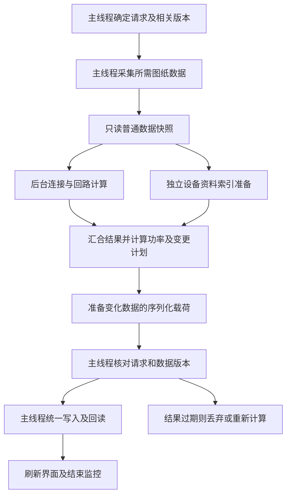

# 存储拆分与按变化范围计算实施方案

日期：2026-10-13
状态：S0 至 S3 已实施并合并至 main，123 合并包已构建；待原图针对验收，S4 与后续条件项未实施

## 1. 范围与实施原则

依据用户上传的 `output.zip`、交付包 116 的监控记录，以及源码基线 `7224947` 制定本方案。先实施存储拆分和按变化范围计算，同时修复监控计时及文档乱码。保留原有保存记录、回路身份、设备库功率、系统图关联、撤销与失败恢复能力。

本文是 [既有性能优化方案](07_识别与系统图生成性能优化方案.md) 的后续实施方案。旧方案中的历史耗时和阶段完成状态不替代本文基线；本文保留基线证据与实施要求；实际完成情况见第 9、16、17 节。当前的 [116 监控交付说明](更新记录/116-全过程动作耗时文档.md) 描述已有行为，本文描述拟调整行为。

用户已授权在新的 Git 分支及工作树执行。实施遵守必要定向检查、源码 UTF-8、CAD2020 加载文件 GB2312、逐阶段提交及真实 CAD 验收边界；没有打开或迁移用户的真实 DWG。

近期实施阶段不引入后台线程、独立计算进程或全面界面重写。先减少需要读取、计算、编码和校验的数据量；按实际结果再决定是否引入后台纯计算。模块解耦、数据传递、后台计算、启动、算法及日志的完整建议统一记录在第 11 至 15 节，列入文档不代表已启动这些扩展实施项。

## 2. 本次实测依据

压缩包包含一次加载、两次 ELSTAT、ELPERF 和 ELTRACE 日志。以 `ELMONITOR-20261013.152203-ELSTAT.md` 的正常完成运行作为主分析样本。

| 区间 | 实测秒数 | 判断 |
| --- | ---: | --- |
| 完整 ELSTAT | 65.906 | 包含用户操作等待 |
| 程序处理 | 41.908 | 本次提效比较的主要口径 |
| 交互等待 | 23.998 | 不能算成程序可优化时间 |
| 加载保存记录 | 5.172 | 其中整份记录解码 3.875 秒 |
| 从已解码记录恢复回路与图块 | 0.015 | 恢复本身很快，瓶颈在读取和解码 |
| 生成前核对源图 | 9.765 | 包含采集 3.500 秒、建立网络 5.906 秒 |
| 系统图及记录写入事务 | 17.328 | 包含编码、校验、图纸写入及回读 |
| 记录序列化 | 9.031 | 包含于写入事务，不能再与事务时间相加 |
| 写前解析 | 3.391 | 包含于写入事务 |
| 定位系统图 | 1.094 | 非当前首要瓶颈 |

加载记录、生成前核对、写入事务三个互不包含的区间合计 32.265 秒，占程序处理约 77%。本次系统图只有 3 项修改、15 项未变，记录载荷仍有 314,759 个字段，说明图形已有增量更新，存储尚未做到对应粒度的增量更新。字段数不是图形对象数量或字节数。

APPLOAD 总耗时 4.765 秒；入口和源码模块加载累计约 0.297 秒，目录确认及资源准备 4.125 秒，默认设备库初始化 0.296 秒。单纯减少源码文件数量不是当前优先方向。

另一份 `ELMONITOR-20261013.151941-ELSTAT.md` 为用户取消的运行：总时间 94.281 秒，程序 61.157 秒。其 `STORE_CONTEXT_READ` 阶段没有正常闭合，19.719 秒中包含后续面板交互及源图核对，不能全部归因于读取。必须先修复异常路径计时收尾，再用该类样本定位耗时。

APPLOAD 文档在压缩包中已是 UTF-8 字节，但正文包含替换字符；两份 ELSTAT 文档仍为系统代码页内容。这证明编码交付和读取链路需要统一，不能据此断言具体在哪个外部环节发生了有损转换，也不能从替换字符完整恢复原文。

## 3. 当前结构与目标边界

仓库有 26 个 LISP 文件：24 个正式启动包运行模块、`load.lsp` 入口、独立的 `batch-number.lsp`。现有职责可归为 8 组：

| 功能组 | 现有文件 | 本阶段调整方向 |
| --- | --- | --- |
| 启动、配置、公共功能 | startup、config、common | 修正监控及编码出口，提供明确的操作上下文 |
| 图纸采集、几何处理 | geometry、simple | 建立可复用的原始对象数据及变化范围 |
| 连接、回路识别与统计 | topology、fixed、circuit-number、statistics | 区分拓扑变化与功率变化，输出明确受影响回路 |
| 设备库 | 7 个 device-* 文件 | 保留功率自动入库，缩小匹配、计算和界面刷新范围 |
| 面板、预览、历史列表 | panel | 读取轻量显示模型，通过流程入口发出操作 |
| 命令与流程组织 | main、diagram-commands | 负责变化分类、数据传递及执行顺序 |
| 系统图生成与更新 | generation、insert-circuit、diagram-update | 保留现有增量实体更新，接收明确变更计划 |
| 记录存储与压缩 | diagram-store、store-compact | 索引、单箱记录、源图快照分别读取和保存 |

现有文件划分不等于功能完全解耦。面板包含计算及历史恢复，设备库界面与面板双向调用，存储与更新模块也存在交叉调用；共享或动态作用域变量参与数据传递。当前主流程同步串行执行。

后续优先明确接口，不为追求文件数量而大规模搬动源码：界面发出操作，流程层计算变更范围，计算层返回结果和变更计划，存储层提交数据，CAD 写入层执行实体修改。逐步把本次结果、源图版本、库版本、读缓存和变化集合显式放入操作上下文，避免读取隐含的“当前箱”状态。

## 4. 存储拆分设计

### 4.1 拟采用的数据分层

以下为逻辑结构，实际字典名、标记名及版本常量在实施时集中定义，不复用旧标记解释新结构。

| 数据层 | 内容 | 读取与写入规则 |
| --- | --- | --- |
| 根目录及提交清单 | 存储布局版本、图纸身份、提交代次、活动索引与数据引用、迁移来源 | 小数据；完整提交后才切换活动版本 |
| 保存记录索引 | 箱体身份、编号、状态、回路数量、记录引用与版本 | 列表只读这一层，不解码几何快照 |
| 单箱业务记录 | 稳定回路 UID、成员句柄、功率、地面状态、排除项、容量、草稿与正式状态、输出关联 | 只读取和更新所选箱；未变箱不重新编码 |
| 轻量恢复数据 | 回路显示、图块种类与数量、设备库引用、必要的历史显示值 | 选中记录即可显示回路和图块，不重新拾取；可与单箱记录同存 |
| 源图快照及依赖 | 用于精确比较、预览、连接判断的数据及依赖关系 | 独立保存、按需读取；数据量大时按稳定对象或空间分区分块 |
| 公共模板 | 模板版本及精确内容 | 内容未变则沿用引用，避免各箱重复存储 |

`source-signature` 当前是完整结构化快照，不是短摘要。拆分后保留其必要信息，通过引用消除重复；不能简单删除它或仅保存哈希而失去历史恢复和精确核对能力。哈希仅用于定位候选内容，复用身份须有精确内容或已验证版本依据。

同一数据仅在语义及内容一致时共享。正式结果与未提交草稿可能属于不同源图版本，不能强行共用一个快照。需要保留全局连接影响范围时，不能只保留已归属本箱的设备而丢掉外围导线及候选设备。

存储布局版本、业务记录版本和压缩编码版本分别管理。延续类型精确的编码规则，REAL、INT、字符串、符号、列表及点对不能在迁移时相互转型；不得用打印文本或小数舍入代替精确值。

### 4.2 读取路径

1. 面板首屏不自动读取大型记录。点击“加载保存记录”后，只读新布局的轻量索引。
2. 选中某箱读取单箱业务及轻量恢复数据，即刻填充回路、图块、功率和状态。
3. 只有预览定位、确实需要源图核对或重新识别时，才读取对应快照和依赖分块。
4. 历史显示与当前源图有效性分别表达：能显示历史记录，不代表已确认当前图纸与历史完全一致。
5. 在同一受控操作内复用已验证对象，避免相邻函数反复读取全部载荷。缓存键至少包含图纸身份、记录身份、代次和相关变化版本，禁止跨图纸错用。

旧布局第一次读取仍可能需要完整解码，随后可生成仅存在于内存的目录和详情视图；本次解码只做一次。不得为了让旧记录列表提速，在“打开”动作中偷偷执行持久迁移。

### 4.3 写入与提交

1. 在内存中生成明确的变更集合，区分业务记录、索引、源图快照、模板和实体输出。
2. 无变化的数据不重新编码、不写回。仅修改功率时，源图快照内容及存储引用保持不变。
3. 对新增或变化分块执行类型精确的写前校验，并准备新代次记录；整个提交流程保留原活动版本。
4. 在现有可撤销事务及恢复标记约束下，写入需要变化的图形和记录，并通过实际 DWG 回读核对变化载荷。
5. 校验新引用的完整性、身份、所有权及适用版本。未变数据仅在仍处于已验证且没有失效事件的上下文中复用；不能只看对象数量、时间戳或一个相同哈希就跳过检查。
6. 全部通过后切换根目录活动代次，并确认提交后状态；失败则回退图形与活动根，保留可恢复的旧数据，不能留下半新半旧的活动记录。

AutoLISP 的撤销组不等价于天然具备原子性的数据库事务。需要用现有事务约束、恢复标记、新旧代次和提交清单共同保证恢复行为，特别覆盖写入中断、最后切换失败、撤销和重做。首轮不自动清理旧代次或备份；垃圾回收单列为后续任务，避免误删共享内容。

## 5. 原有保存记录兼容与迁移

### 5.1 必须兼容的输入

| 原记录类型 | 新版读取要求 |
| --- | --- |
| 无类型标记的早期文本记录 | 通过原有兼容解析器读取并校验，保留原字节 |
| `EL_TYPED_V1` | 保留原生类型值及完整业务内容 |
| `EL_COMPACT_TYPED_V2` | 沿用对应压缩解码规则后转换到统一内存模型 |
| `EL_COMPACT_TYPED_V3` | 兼容当前 116 包记录 |
| 新拆分布局 | 依根目录、单箱记录及各分块版本读取 |
| 未知未来版本、损坏记录 | 明确说明不能处理，保留原记录，不当作空库覆盖 |

保留已有压缩包内部的 `format-version`、`codec` 识别逻辑。旧布局的逻辑 `schema-version = 1` 与上述物理编码标记不是同一层版本。

### 5.2 迁移时机和一致性

- 浏览、打开、预览、取消均不触发 DWG 记录迁移，不清理旧数据，不强迫用户重新拾取。
- 首次明确保存或生成时才允许迁移；一次迁移整张图的旧逻辑记录，建立完整的新索引，避免未操作的其他箱被漏掉。不引入日常使用的额外确认弹窗。
- 迁移前完整解码并检查原记录，保留原布局及原始载荷的可验证备份；新布局暂存完成后，通过兼容适配层重建原逻辑视图，与原记录逐字段、逐类型精确比较。
- 当次编辑与格式迁移分开核对：先证明旧业务内容的无损转换，再应用本次变更；不能拿编辑后的值冒充原值一致性。
- 保留稳定 `diagram-id`、`circuit-uid`、来源箱句柄、源图基线、正式及草稿状态、输出句柄、功率、地面标记、排除项、容量、编号、模板与人工位置等。已有解析器接受但本轮未理解的扩展字段也必须保留，不按新字段白名单静默丢弃。
- 草稿引用正式源图基线的 `formal-source` 语义必须保持；不能把不相关的正式快照当作草稿基线。
- 新记录回读及引用核对全部通过后，才切换活动根。失败继续保留旧活动记录，按原有事务恢复图形；以后重试不能形成重复箱体或重复回路。
- 首次迁移可能比后续保存慢，监控必须单列迁移耗时。旧图首次读取和首次迁移不能与新布局的日常操作混作同一性能样本。
- 缺少历史成员数据的早期记录，继续走现有兼容恢复路径；无法可靠恢复时保留原值并明确状态，不凭猜测补全，也不让所有旧记录都重新识别。

### 5.3 旧插件与新布局的边界

本方案首先保证“新版能读取和继续使用原有记录”，不声称未更新的旧插件天然支持新布局。新旧布局同时存在时，只能有一个明确的活动权威版本。

迁移后保留的旧记录是恢复依据，不是持续同步的第二份活动数据。若发现旧入口或其他插件修改了保留旧记录，须识别为冲突并停止静默选择，不能继续使用较旧的新索引，也不能把修改悄悄覆盖。实施时覆盖跨会话重新加载及旧入口写入的冲突检测。

现有 `ELSTORELEGACY` 入口不得失效：需要适配为从新布局完整重建旧逻辑记录、写出 `EL_TYPED_V1` 并回读核对，然后在同一可恢复流程中停用新活动根，使后续读写权威回到旧布局。不能只导出一个过期的旧备份。此降级为用户显式操作，不在每次保存时双写两套全量数据。

## 6. 按变化范围计算

### 6.1 变化分类与执行范围

| 变化类型 | 必要计算 | 不应触发的工作 |
| --- | --- | --- |
| 无数据变化，仅翻页或选中记录 | 更新显示或读取选中详情 | 整库写入、源图扫描、网络重建 |
| 单个设备类型功率变化 | 更新设备库值，按设备类型到回路的映射重算受影响回路，更新对应文字或档位 | 重新计算几何接触和网络连接 |
| 地面标记、排除项变化 | 更新相关分类、成员统计及输出计划；复用仍有效的物理连接结果 | 无依据地全图重新采集 |
| 容量、预留或输出模板变化 | 重算输出布局及变更计划，必要时结构更新 | 源图几何未变时重新识别平面连接 |
| 回路编号文字或属性变化 | 重读对应编号依赖，校验编号并更新相关输出 | 单纯编号变化导致几何网络重建 |
| 导线或设备新增、删除、移动、属性或图块定义影响几何 | 重新采集受影响对象，扩展到连接分量及邻近候选范围，重算受影响回路 | 将检查限制到旧成员而漏掉新接入对象 |
| 识别图层、连接规则、容差变化，或变化来源不可追踪 | 扩大失效范围；无法证明局部正确时完整重算 | 冒险复用旧结果 |

共享设备库功率仍按用户要求在填写后保存。不能为减少 I/O 改成离开面板才保存，或只保留当前箱覆盖值。通过设备身份和版本更新本次内存快照及相关回路，避免整批重新匹配、重建图例；不相关箱的旧已保存功率不得在浏览时反向覆盖设备库。

### 6.2 变化追踪与缓存有效性

维护相互区分的变化版本：源图几何、编号输入、识别规则、设备库、当前箱业务记录、系统图输出。更新受管输出不应无条件使源图几何缓存失效，但未知原生回调可能修改源图，仍须按证据处理。

变化追踪必须覆盖对象修改、追加、删除、撤销、重做、文档切换、重开图纸、块定义及相关外部依赖变化；不能只追踪当前已知成员。反应器或通知回调只记录变化标识，不在回调中扫描、绘图或保存，避免重入。

实现可靠的变化追踪前，先采用精确的轻量源对象比较：允许扫描并比较候选原始数据，但相同则复用网络，不再为了判断相同而建立整张网络。原始数据比较必须与当前识别语义等价，包含新增候选、动态块形态、变换、图层及接触相关属性，不能仅比较实体句柄或数量。

跨命令、重开图纸和从旧记录恢复时，默认无可信的内存几何版本；先核对后建立可复用上下文。局部计算与全量计算必须得到相同的归属、问题诊断和功率结果。几何变化可能传播到相邻回路甚至其他箱，不得以“只更新当前箱”为理由忽略传播。

生成提交前保留一次与本次依赖匹配的最终有效性检查。鼠标放置、预览、原生命令、外部编辑等边界后的结果需要重新确认。取消后回到面板时保留功率和草稿，但不得保留已经失效的几何有效标记。

### 6.3 计算与持久化的配合

计算层输出“变化对象、受影响回路、变化记录及引用”的明确集合。存储层据此只编码变化记录和必要索引，不从面板状态反向猜测；系统图层沿用已有增量操作，只改实际不同的实体属性，保留未变句柄及允许的人工位置。

UI 刷新范围同样跟随变化集合：改功率不重建未变图例，切换图例不重算全部回路。独立的保存、生成及设备库发布各有状态，失败不能以另一路已经成功为由报告全部成功。

## 7. 监控计时修复

首先核对 `TransactionVerifiedRead` 等捕获异常但仍继续操作的调用边界。当前证据表明 `STORE_CONTEXT_READ` 未闭合，具体异常来源尚未确认，不能将阶段名称直接当作根因。

拟采用以下约束：

1. 每个阶段有唯一令牌、父令牌和明确的完成状态。正常返回结束当前阶段，捕获异常时先将本次检查点之后的未结束阶段按中断收尾，再执行回退或返回面板。
2. 不改变业务函数原有返回值和异常语义；监控写失败不能改变保存或生成结果。被捕获的错误在其自身阶段记下原因，不等到命令最后才补写。
3. 正常结束按后进先出检查令牌关系；如发现计时栈异常，记为计量异常，不让后续面板或源图处理挂在已结束操作下。
4. 面板回调执行时暂停输入等待计时，内部再次进入拾取时单独记录等待。Esc、预览返回、保存后留在面板和二次生成均需正确恢复计时状态。
5. 保留总耗时、程序耗时、交互耗时、阶段包含关系及退出状态；父子耗时不相加。列出未被直接子阶段覆盖的耗时，避免把未设点的工作错误归因。
6. 增加与本方案对应的计数：索引读取、详情读取、快照分块读取、编码及写入字段数、变化记录数、网络重建次数、局部回路计算次数、缓存失效原因、迁移和回退。
7. 动作明细仍在内存中批量记录，结束时集中输出；文档格式化、编码转换、写盘和关闭文件的总耗时单列，避免新增监控开销被隐藏。强制结束 CAD 进程无法执行收尾的边界需继续说明。

## 8. 监控文档乱码修复

新生成的监控 Markdown 统一为真正的 UTF-8，建议带一个 BOM 以便常用 Windows 编辑器识别，换行统一为 CRLF；不得在内容里额外拼接 CR 后再让写入接口补换行。

源码继续 UTF-8，供 AutoCAD 2020 加载的 LISP/DCL 继续严格转换为 GB2312。这与运行时监控文档的 UTF-8 输出是两件事，不能把 UTF-8 源码直接交给 CAD2020 加载来解决日志编码。

AutoCAD 2020 不依赖新版 `open` 的 UTF-8 参数。实施时复用或封装经过确认的文本流编码出口，例如已有设备库文本 I/O 使用的 COM 能力：整份文档一次转换和写出，明确 Charset、BOM、关闭及释放规则，避免逐行动用 COM。必要的转换耗时纳入监控输出开销。

先写临时文件，写入关闭成功后再发布唯一正式文件。失败保留内存数据并提示，不留下看似成功的半份报告。UTF-8 出口不可用时，明确提示并保留数据；若提供系统编码回退，应另用明确标识的 `.gbk.txt`，不能把 GBK 写入声称 UTF-8 的 `.md`。

已有 ELPERF/ELTRACE 和监控文件按原编码只读兼容，不覆盖、不混合追加不同编码内容。导入时优先识别 BOM，再严格尝试 UTF-8 和已知旧系统代码页；遇到已有替换字符应标注有损来源，不继续猜测恢复。新监控的中文内容须在真实 CAD2020 生成后用常用编辑器直接打开核对。

## 9. 实施顺序与完成条件

| 阶段 | 工作内容 | 必须达到的完成条件 | 当前状态 |
| --- | --- | --- | --- |
| S0 | 明确计时异常边界，修复令牌收尾和 UTF-8 文档输出 | 保存返回面板及 Esc 后阶段不串接；新中文文档可直接读 | 已实现；待 CAD 验收 |
| S1 | 定义分层数据契约、统一内存适配层和旧格式读取 | 旧数据完整可读；仅打开不写图；未识别版本不覆盖 | 已实现；旧格式适配器验证通过 |
| S2 | 新布局读写、一次性迁移、提交与回退、旧格式导出 | 索引独立可读；无损迁移；中断可恢复；旧导出入口继续可用 | 已实现；迁移与回退适配器验证通过 |
| S3 | 变化分类、依赖映射、同一操作内复用；先实现功率快路径 | 几何未变时不重建网络，不写源图快照，只更新受影响记录与输出 | 已实现；局部统计及网络候选复用验证通过 |
| S4 | 可靠变化追踪和局部几何计算，补齐失效回退 | 新增、删除、撤销等不会漏识别；不能证明正确时回退全量 | 未实施；保留完整采集与失效回退 |
| S5 | 原图针对验收、打包及交付记录 | 以真实日志比较日常操作与首次迁移，明确通过及未通过场景 | 已打包；待原图实测 |

每阶段作为可审阅的独立变更提交。优先交付 S0 至 S3 的闭环；S4 未达到可靠性要求时保留完整源图核对，不能为达到速度指标降低正确性。具体文件拆分随接口落地决定，不在第一阶段重写所有模块。

主要落点为 `common.lsp` 的监控与编码出口、`diagram-store.lsp` / `store-compact.lsp` 的存储适配、`panel.lsp` 的索引及恢复视图、`diagram-commands.lsp` 的操作组织、`diagram-update.lsp` / `simple.lsp` 的变化判断，以及设备库输入与匹配模块的局部刷新。

## 10. 必要验证与性能验收

仅对本次引入的存储格式、变化路径和监控做定向验证，不以全量重复测试代替原图实测。

| 场景 | 必要证据 |
| --- | --- |
| 旧文本、Typed V1、Compact V2/V3 的混合内容样本 | 每种受支持格式无损读取；多箱、草稿、正式记录、扩展字段及精确数值保留 |
| 浏览旧记录后取消 | 未修改 DWG 存储，不触发迁移；原回路、图块、功率可显示 |
| 首次迁移成功及关键写入位置故障 | 只有完整新版本可成为活动根；失败仍可恢复旧业务数据，未操作箱不丢失 |
| 新布局保存、重开、撤销与重做、显式旧格式导出 | 单一活动权威版本，实体及记录状态一致，旧版入口可读取导出数据 |
| 仅改功率，源图几何不变 | 设备库记住值；受影响回路结果正确；快路径不重建网络、不重写快照 |
| 导线增删、块形态变化、编号变化、切图及追踪失效 | 变化范围正确，结果与全量计算一致，不漏新增候选或跨箱影响 |
| 保存后留面板、预览 Esc、二次生成及异常回退 | 无未闭合阶段吞入后续动作，等待和程序时间分类正确 |
| 中文监控输出及写文件失败 | 字节严格符合 UTF-8、中文可读；失败关闭资源、不影响业务结果 |

真实 CAD 验收复用用户原图，依次进行：读取旧记录、首次保存迁移、再次打开和改功率生成、关闭重开、必要的撤销及一处源图修改。重点保留 ELMONITOR、ELPERF 和异常时的 ELTRACE，避免无目的的大量重复运行。

性能比较需区分冷读取、暖读取、首次迁移、普通保存、首次生成及原位更新，使用相同图纸与相同行为。先以工作量验收：新布局列表不读取大型快照，单箱修改不编码未变箱或快照，功率快路径不重建网络，同一受控区间不反复做相同全量校验。随后比较程序耗时和生成提交至返回时间，不把用户停顿算作提速。

不提前承诺固定秒数或提速比例。若工作量已缩小但耗时仍高，再根据新日志定位编码算法、几何索引或原生 API 调用；是否引入 .NET 或后台纯计算另行评估。

## 11. 模块解耦与数据传递的完整建议

### 11.1 从文件划分转为明确职责

当前主要交叉依赖包括面板与设备库界面、存储与系统图更新、几何与统计。第一步应梳理调用方向及共享状态的拥有者，再逐项提取接口；不是把一个大文件拆成多个仍相互调用的小文件。

| 目标职责 | 接收与返回 | 边界要求 |
| --- | --- | --- |
| 命令和操作协调 | 用户操作、文档身份 → 操作上下文、执行结果 | 唯一决定读取、核对、计算、保存、生成的顺序 |
| CAD 访问适配 | 候选范围与读取请求 → 普通数据快照；变更计划 → 写入结果 | 集中管理原生对象访问、选择、事务及视图操作 |
| 纯计算 | 已知版本的数据、规则及变化集合 → 连接、回路、功率与问题列表 | 不读取界面控件，不修改 DWG，不发布设备库 |
| 设备库服务 | 稳定设备身份、编辑值及库版本 → 已提交库快照或明确失败 | 提供数据与提交接口，不直接操纵面板 |
| 存储服务 | 索引、详情或提交请求 → 版本化业务数据及提交结果 | 不调用面板或决定是否绘图；旧格式适配集中在本层 |
| 系统图计划与执行 | 业务结果、输出基线 → 增量计划及已执行结果 | 计划计算与原生实体写入分离 |
| 界面显示 | 轻量显示模型 → 编辑操作 | 不通过刷新、翻页、选中事件隐式重算或整库写入 |
| 监控 | 操作标识、阶段事件与计数 → 文档和诊断结果 | 作为旁路记录，不成为业务成功条件 |

存储编解码需要的通用类型与错误契约应下沉到公共数据层，避免编解码器与业务存储相互调用；几何数据结构与统计接口同样单向依赖。暂时保留兼容外观函数，以减少一次性改动面。

### 11.2 明确数据契约

建议依次明确 `ReadSnapshot → BuildNetwork → ComputeCircuits → PrepareViewModel → PlanUpdate → CommitChanges` 的输入与输出。上述名称为接口职责示意，并非本轮新增函数。

采用以下数据对象，字段细节在 S1 与 S3 定义，避免每层都携带整张图的全部内容：

- 操作上下文：请求标识、文档身份、当前箱身份、相关版本、变化集合、缓存引用、取消状态及监控标识。
- 源图快照：只读、可追踪来源和版本的普通数据；大内容按块引用，不由下游随意修改。
- 识别结果：稳定回路身份、成员关系、编号依据及问题列表。
- 编辑状态：用户输入、原始未通过校验的文本和局部覆盖值，与已提交结果分别保存。
- 显示模型：当前页回路、图块、功率、图例引用和状态，不要求界面了解完整存储布局。
- 变更计划：需修改的实体、记录、索引及数据引用，包含所依赖的源图与设备库版本。
- 提交结果：已提交版本、实体和存储变更、校验依据或具体失败状态，不仅返回一个容易误判的真值。

数据在当前 LISP 进程内主要通过函数参数和返回值传递，不能把跨文件调用误认为网络传输，也不能假定每次传参都会深拷贝全部数据。应重点测量实际发生的完整遍历、稳定化转换、序列化、解码和原生 API 读取。仅改传参形式而不减少这些工作，不保证提速。

逐步用明确上下文替代隐含的 `*EL:...*` 当前状态；共享缓存须有拥有者、作用域及失效规则。操作返回时清理临时对象，稳定只读内容可按受控版本复用。不要因取消一个箱的操作误清除另一个箱仍有效的数据，也不要把不同文档的缓存混用。

### 11.3 缓存分层与界面响应

分开管理源图对象、网络结果、回路成员、设备库匹配、存储详情及图例缓存，避免一个功率变化使所有层一起失效。记录每次命中和失效原因，使用第 6 节的变化版本验证适用性。

在输入接口边界和可能触发外部修改的原生调用后进行必要核对；同一受控操作内相邻函数复用已经核对过的结果。一次回读确认的存储结果明确传回调用者，避免为了获取同一数据再次完整 `StoreRead`。这不意味着永久取消实际 DWG 校验。

图例按稳定设备身份及图形资源版本定位，显示名称变更不应让已有图例丢失。数值变化只刷新数字和受影响回路；图形、资源或选中设备变化时才重新加载对应预览。此规则与功率自动入库同时成立。

耗时操作应显示当前阶段和真实完成情况，保存后继续显示已填数据，失败或取消保留用户编辑。不增加反复确认弹窗；“记录已显示”“当前图纸已核对”“设备库已保存”“系统图已提交”分别报告，避免尚未完成就显示成功。

## 12. 后台计算与并行数据处理建议

### 12.1 边界与引入条件

现有同步 LISP 调用不具备任务队列或后台计算；拆文件不会自动变成多线程。AutoCAD 原生 API 的访问必须遵守主线程要求，后台处理先提取出来的普通数据，再将结果交回主线程。依据：[Autodesk 关于后台处理与主线程图纸写入的说明](https://blog.autodesk.io/running-network-io-in-autocad-net-commands/)。该资料用于说明线程边界，具体实现 API 和运行时仍需适配 AutoCAD 2020，不能直接照搬较新版本示例。

仅在 S0 至 S5 的存储和重复计算优化完成后，剩余纯计算或界面阻塞仍为主要问题时，引入 .NET 组件或独立计算进程的定向原型。先验证一个明确瓶颈，保留现有同步流程作为对照和可用回退，不全面迁移所有模块。

### 12.2 拟采用的执行流程

图中仅 D 与 E 在确实不存在相互依赖时具备并行候选资格；源数据不足或设备资料参与连接判定时必须调整依赖顺序。不能在回路结果尚未形成时提前保存最终业务记录。

| 工作 | 并行建议 |
| --- | --- |
| 不涉及 CAD 对象的候选几何运算、已划分独立范围的分析 | 可评估后台执行；跨边界接触和归属仍须统一汇合 |
| 基于已有成员的功率统计、独立资料索引 | 数据量足够且依赖明确时可并行，小任务直接同步可能更快 |
| 已确定变更内容的编码与压缩准备 | 可移到后台；保留类型精度、格式兼容和提交前版本核对 |
| 图纸实体读取、写入、原生选择、撤销组、视图及 DCL 操作 | 留在 CAD 主线程；不把原生对象传给工作线程直接调用 |
| 同一 DWG 的活动根切换、同一设备库的发布 | 保持串行提交和冲突检测，不并发写两份权威状态 |

### 12.3 任务与数据安全

工作线程或进程只接收不可变普通数据，不接收可直接操作的 ENAME、COM 或数据库对象。数据引用须具备文档、请求和版本信息，避免把旧箱的晚到结果显示在新箱中。

任务采用有界队列和有限并发量；同一资源的提交只有一个执行者。用户继续修改时标记旧任务过期，允许合并尚未执行的可替代计算；不能合并掉已经承诺执行的设备库持久保存。Esc 取消待执行或可中断计算，已经进入写入事务的操作按既有恢复边界结束，不能强杀线程留下半次提交。

后台计算期间若发生切图、关图、撤销、库版本变化或新的源图编辑，结果返回时重新校验，不满足版本条件的结果不得写入。任务状态包括排队、运行、过期、取消、失败、完成和提交，计算完成不等于提交完成。

现有模态 DCL 不能因增加后台任务就假定自动具备流畅的实时进度和任意异步回调。原型必须验证主线程安全的调度与进度呈现方式；必要的非模态界面调整作为独立后续决策，不隐含在当前存储重构中。

性能评估应计入快照提取、任务调度、数据传输或复制、内存占用、结果汇合及主线程提交。若调度和传输成本抵消计算收益，保留同步路径。后台化能改善响应性，但只有实测总程序时间下降才能称为整体提速。

## 13. 启动、算法及日志的进一步优化

### 13.1 启动与资源准备

本样本源码加载约 0.297 秒，优先检查 4.125 秒的目录确认及资源准备。继续细分目录查找、已有资源检查、缺失资源释放和设备库初始化，区分首次加载与已安装后的再次加载。

复用已经完整落地且版本适用的运行目录，仅在资源缺失、版本改变或校验失败时执行相应修复；不得把每次加载都变成重新释放所有资源。版本标记必须在完整资源树建立后才写入，不能仅因存在一个标记文件就认定所有内容有效。

只在后续测量证明有收益时，考虑把与当前命令无关的资源准备延后到首次使用。公共定义不能因延迟加载而造成命令缺失、重复初始化或首次拾取反复弹出路径选择。保留一个清楚的 APPLOAD 入口，不要求用户手动加载多个模块，不修改 `SECURELOAD`。

### 13.2 单次计算与编解码算法

如果去掉重复处理后仍慢，再按实际热点检查：

- 先按配置的图层、图块和对象类型过滤，再读取昂贵的几何、包围盒或原生属性，避免无关对象进入后续计算。
- 对句柄到对象、设备类型到成员、成员到回路的查询建立索引，减少大列表中的重复线性搜索；索引构建成本和占用同样计量。
- 对几何候选采用适合当前图纸的空间索引或分区，并复用同一操作内的轮廓模板及稳定几何结果。索引只缩小候选范围，实际接触仍按原精确几何规则判定，不能把“靠近”改成“连接”。
- 对序列化和解码分别记录对象数、字段数及字节量，识别重复模板查找、重复完整比较、字符串拼接和列表遍历等热点。先减少待编码内容，再评估改变编码算法或编译型实现。
- 优化源图签名时避免反复构造庞大的文本，保留结构化类型及精确比较语义；共享数据的去重不能丢失字段或数值精度。
- 完全无变化时，保留必要的有效性及所有权核对后结束；不重新写记录、不反复设置相同实体属性。视图定位约 1 秒属于次要项，只有其占比明显升高时再分析重生成和缩放次数。

已有的缓存、空间索引或增量逻辑应先确认实际命中情况，不重复造一套同样的数据结构。所列热点为检查方向，不是本次已测出的独立根因。

### 13.3 业务诊断日志开销

新动作监控已经集中写出，但现有业务日志仍可能逐条打开、写入、关闭。成功样本记录了 630 次日志打开，先测格式化与 I/O 的真实耗时，再决定是否采用小批量缓冲。

如采用缓冲，保留命令开始、错误、事务关键边界和退出时的及时写出，限制缓冲大小；发生异常时优先写出最后阶段和上下文。高频逐顶点信息默认使用计数或阶段汇总，需要精查时再开启细节，不能为减少日志丢掉失败恢复所需信息。

性能基线保持正常日志开启。临时关闭业务日志只能作为定位开销的对照，并明确标记；不能把关闭诊断后的结果当成正常交付性能。缓冲及编码改动需保持原日志可读、异常路径仍可追踪，不能将不同编码混合追加到同一文件。

## 14. 全部建议与实施优先级对照

| 建议 | 主要解决的问题 | 计划位置与优先级 |
| --- | --- | --- |
| 监控令牌收尾及 UTF-8 文档 | 阶段耗时串接、文档乱码 | S0，近期先完成 |
| 目录索引、单箱记录、独立快照与公共模板 | 列表解码大记录、每次保存处理全量数据 | S1 至 S2，近期重点 |
| 旧记录兼容、迁移回退及旧格式导出 | 已有项目数据连续可用 | S1 至 S2 的必要组成部分 |
| 功率、编号、几何、输出变化分别计算 | 修改小数据导致大范围重算 | S3 至 S4，先功率路径 |
| 分层缓存、显式上下文、复用已验证提交结果 | 相邻调用重复读取及完整比较 | S1 至 S4 随接口调整实施 |
| 设备库局部匹配、图例稳定身份和局部刷新 | 输入卡顿、改名或改功率导致图例问题 | S3 随功率路径实施 |
| 明确服务职责、减少双向依赖 | 隐含状态导致重复工作和后续并行困难 | 随近期变更逐步完成，不单独全面重写 |
| 完全无变化时避免持久写入 | 无变化仍付出完整保存成本 | S2 至 S3，保留必要有效性检查 |
| 可靠源图变化追踪及局部几何分析 | 每次重新采集和建立整张网络 | S4，正确性不足时保留全量回退 |
| 启动资源复用及按需准备 | 首次与再次加载的目录、资源成本 | S5 之后根据新日志评估 |
| 候选过滤、索引、模板复用及编解码热点 | 剩余单次计算开销 | S5 之后按热点选择，不全量重写 |
| 业务日志小批量写入和细节分级 | 重复文件 I/O 与高频格式化 | 先计量，收益明确时定向实施 |
| .NET 或独立进程的纯计算原型 | 剩余 CPU 密集计算及主界面阻塞 | 后续条件项，先一处瓶颈原型 |
| 有界队列、取消及过期结果处理 | 后台结果错写、并发提交和交互失控 | 引入后台计算时必须同时实现 |
| 基于原图的分场景性能复核 | 避免用用户等待或模拟时钟夸大收益 | 各阶段保留必要证据，S5 集中交付 |

所有建议均已纳入本文，但执行顺序仍遵守用户确定的“先存储拆分和按变化范围计算，并修好计时与乱码”。后续条件项不自动进入近期改动范围；需要在近期方案落地后用新日志确定是否值得实施。

## 15. 后续评估与停止条件

每轮只选择新日志中占主要程序时间的一项，记录修改前后的工作量、程序耗时、交互及提交后等待，不为证明优化而进行大规模无关检查。模拟时钟用于证明计时规则，不能证明真实 CAD 提速。

若索引已轻量、功率修改不重建网络、未变快照不重写，且使用响应已满足需要，则结束这一轮性能改动，不为“模块更纯”或“必须并行”继续扩大范围。若仍存在明显瓶颈，再从第 13 节选取对应项；只有纯计算或主线程响应仍是关键问题时才进入第 12 节原型。

原型如出现结果不一致、无法可靠取消、旧数据不可恢复、CAD2020 运行时不适配，或跨线程传输成本大于收益，应保留稳定同步路径，记录原因，不强行替换。评估阶段不删除旧记录解析器、不改变用户的保存意图、不牺牲几何连接和功率统计正确性。

## 16. 本轮交付边界

本轮在 `codex/storage-change-scope` 分支、独立工作树实施 S0 至 S3，并按阶段提交。117 修复监控，118 接入拆分存储，122 交付变化回路计算与网络候选复用；原拟用 119 与已有包冲突，现已更正，包内版本标识同步更新。构建与定向适配器验证代表对应自动结果，不代表原始 DWG 或真实 CAD 已通过验收。本轮后按用户授权合并至 main，合并版为 123；未推送或操作用户 DWG。

## 17. 实施记录与剩余边界

- S0：`f8e2e70`，异常计时即时收尾，监控文档通过 UTF-8 流一次写出并安全发布。详见 [117 更新记录](更新记录/117-监控计时与UTF8输出.md)。
- S1/S2：`846c4fa`，索引/箱体详情/大字段拆分，四种旧格式只读兼容、事务迁移及最新数据旧格式导出。详见 [118 更新记录](更新记录/118-按箱拆分存储与兼容迁移.md)。
- S3：功率统计按回路依赖复用，完整源采集及轮廓复核通过后省略建网，保留图例缓存；本阶段随代码与必要用例提交。详见 [122 更新记录](更新记录/122-按变化回路计算与网络复用.md)。

首次旧记录加载仍需完整旧解码；首次明确保存执行全量无损迁移。日常列表读取只访问根索引，选定箱体才读自身详情。完整业务写前仍核对全部可达记录，以防其他箱被外部修改；本轮主要减少重复解码、整库序列化和未变网络构建。

源图几何尚未实现 S4 的可靠局部追踪，所以完整采集与轮廓确认仍可能占用时间。历史块暂不回收。后台线程、算法重写、日志批量写入及其他第 11 至 15 节条件项继续保留为后续评估建议。本轮没有据适配器运行时间宣称真实 CAD 提速比例。

合并交付：2026-10-13 保留 main 的断口续接、中文路径身份、大记录保存、回路排序和原系统图更新修复；拆分记录的大字段、旧记录备份及首次根记录创建共用大记录创建入口。详见 [123 合并交付记录](更新记录/123-性能优化合并到main.md)。
